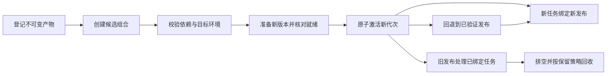

# AgentOS 组件独立发布与热插拔

2026-11-18 · 设计规格。关联 REQ-MOD-001、REQ-MOD-002、REQ-TOOL-002，实施由 TASK-008、TASK-017 负责，复用 TASK-009 的运行观测。现有 M1 由 API 和 worker 启动时读取同一发布清单，支持文本 Skill 和内置检索 Tool。本文定义组件独立发布、组合激活和兼容升级的后续交付。[现有能力与接入方式](../changes/capability-monitoring.md) · [组件调用契约](../specs/component-contracts.md)

## 与 DeepSeek Harness 对照

对照 DeepSeek 官方预发布 `dsh-v0.2.2-rc.4`，提交 `3f321d32bfe382212a8ed8785c1d47a5a300aa23`。DSH 用 Cordis 将模型适配器、工具注册表、会话日志和 Agent 循环模块化。Bundle 负责分发配置和代码，Profile 负责按顺序组装 Bundle、用户配置和补丁。AgentOS 对应采用组件产物、组合发布和项目激活三个对象，让产物发布和项目流量切换各自独立。[DeepSeek 官方发布](https://github.com/deepseek-ai/deepseek-harness/releases/tag/dsh-v0.2.2-rc.4) · [DSH 架构](https://github.com/deepseek-ai/deepseek-harness/blob/3f321d32bfe382212a8ed8785c1d47a5a300aa23/docs/architecture.md)

| 方面 | DeepSeek Harness | AgentOS 设计 |
| --- | --- | --- |
| 加载与替换 | Cordis 插件提供服务、事件和可撤销的注册。Web 的部分配置和插件变更可热重载。Headless、SDK、ACP 默认关闭 HMR，部分操作返回需重启。 | 每种组件独立出版本并通过稳定契约接入。工作进程可同时解析多个兼容版本。激活只切换项目默认发布，已接收任务沿用其版本。 |
| 权限与故障 | Plugin Manager 变更作用于当前 Profile，Host 插件代码在 DSH 进程内运行。部分更新先移除旧包再安装新包，失败时尝试恢复。 | 先验证并准备候选，再原子切换。插件代码运行在受管隔离进程或独立服务，通过网关得到本次调用所需的身份、预算和权限。 |
| 注册与观测 | Tool 可全局或按 Agent 作用域登记，每步确定获准工具集合。会话日志记录工具请求与结果，运行中的事件供观测或拦截。 | MySQL 关联项目、发布代次、任务、尝试、实际组件摘要和外部回执。控制面记录注册、验证、激活、排空、撤销和回退。 |

[DSH Plugin Manager](https://raw.githubusercontent.com/deepseek-ai/deepseek-harness/3f321d32bfe382212a8ed8785c1d47a5a300aa23/packages/boot/plugin-manager/README.md) · [DSH 工具注册与执行](https://raw.githubusercontent.com/deepseek-ai/deepseek-harness/3f321d32bfe382212a8ed8785c1d47a5a300aa23/docs/subsystems/tools.md) · [DSH 会话事件](https://raw.githubusercontent.com/deepseek-ai/deepseek-harness/3f321d32bfe382212a8ed8785c1d47a5a300aa23/docs/subsystems/session.md)

## 组件、组合与部署边界

| 对象 | 契约 |
| --- | --- |
| 组件版本 | 用 `kind / name / version` 标识，存内容寻址的产物引用、SHA-256、清单及契约摘要、来源和所有者。清单以 `provides`、`requires` 声明接口和兼容范围，同时声明配置、输入输出和状态 Schema，权限、副作用、幂等、取消及隔离能力。重复登记同版本同摘要返回原记录，版本已存在且摘要不同则冲突。凭证通过运行时引用取得。 |
| 组合发布 | 解析依赖版本范围，记录实际生效的精确版本和摘要、配置与运行环境，形成不可变发布 ID。对依赖缺失、冲突、循环、权限不满足和不兼容 Schema，返回校验详情。生产认证使用实际发布组合和环境。 |
| 项目激活 | 以租户、项目和 Profile 定位激活记录，保存发布 ID 和单调递增代次。显式授权的变更通过比较旧代次原子更新。同一事务写入审计。任务受理在事务中解析并固定发布，子任务和重试沿用已绑定组合与根权限。 |

每个模块维护独立版本、产物和兼容窗。文本 Skill、Prompt 和声明式策略通过版本目录分发，由消费者按固定摘要加载。可执行组件需要独立可滚动更新的进程或服务边界，消费者通过稳定接口使用；同镜像内的实现只能在已具备的版本之间切换。控制面、运行时、上下文、模型网关、Tool、记忆、执行器和观测模块逐步达到独立部署。部署验收以服务实例启动时间、容器 ID 和镜像摘要核对变更范围。MySQL 继续保存权威元数据、任务状态和账本。[运行契约](../specs/runtime-contracts.md)

## 激活、排空与回退

1. 发布候选前验证产物完整性、版本兼容、隔离和能力声明。执行目标环境就绪探针、契约样例及依赖检查。候选失败保留原因，原激活指针继续服务。
2. 准备完成后并行保留可接收绑定版本的执行实例，原子切换项目激活记录。worker 领取前确认所需版本可用。已受理任务按绑定版本继续处理，原版本暂时不可用时保留原引用并报告不可用。切换默认组合、暂停新任务领取和撤销权限各有独立审计事件。
3. 固定版本仍受当前授权、取消、租约和预算约束。紧急撤权提交后，下一次执行或发送准入重新检查当前策略；已准入的在途操作按运行契约取消或核对，费用回执仍归原操作。组件停用与授权撤销使用各自的接口和状态。
4. 对旧发布停止接受新任务，保留已绑定任务、可恢复检查点和未核对操作所需资源。仅在这些引用排空并满足保留策略后回收。回退以新代次切回已验证且仍兼容的组合，旧任务及账本保留其实际版本和回执。
5. 有状态组件先做向后兼容的增量数据库变更，验证新旧读写与可重复回填，再切换生产读写路径。只有依赖旧 Schema 的版本排空且回退窗口结束后，才收缩字段或表。共享 MySQL 迁移由组件所有者声明表和 Schema 兼容范围，由一次受控迁移执行者顺序应用。发生不可逆状态变化的版本须先具备前向修复或经演练的恢复方案。发布回退和数据库恢复使用独立操作记录。

## 实施顺序与验收

1. 先用文本 Skill 接通组件目录、依赖校验、项目激活和审计。让同一 Tool 支撑两个 Skill 版本，验证切换发生在任务受理时。
2. 将内置检索 Tool 接入同一目录。从同契约的两个已验证实现开始，再支持受管隔离运行的 Tool 或 MCP 适配器。发布时核查输入输出约束及执行范围，并在轨迹保留实际版本、摘要、耗时和失败码。
3. 将上下文策略、模型适配和执行器纳入独立发布。同一组合沿用快照、账本和取消准入。记忆、编排和其他有状态能力先核查跨版本状态、迁移、排空及恢复，再发布可并存实现。控制面和运行时按版本化契约滚动更新自身。

| 验收编号 | 执行动作及观察结果 |
| --- | --- |
| AC-010 | 同项目启用 Skill 或 Tool v2。更新前采集相关实例启动时间、镜像、配置或产物摘要。更新后，新任务引用 v2，排队及运行中的 v1 任务保留 v1；无关服务实例标识、启动时间、镜像摘要和其他组件的已绑定摘要一致。依赖缺失和摘要冲突返回可识别错误。 |
| AC-011 | 并发激活相同旧代次，只有一次切换成功。模拟候选就绪失败、中途中断、回填重试和激活后回退。校验原发布能继续处理既有任务、回退生成新代次、不可兼容组合无法激活、排空前旧版本仍可恢复，账本与回执可逐笔核对。 |
| AC-012、AC-023 | 按项目检查登记、激活、发现和调用权限。撤权与调用并发时，以准入事务排序判定；撤权提交之后发起的新准入拒绝，包括仍绑定旧组件的任务。 |
| AC-013 | 在一次运行轨迹核对任务尝试、固定发布、组件实际版本与摘要、失败或耗时及结算。再用控制面审计查候选验证、激活和回退，区分可用组件目录和实际运行记录。 |

[验收规范](../specs/acceptance.md) · [TASK-008 与 TASK-017](../plan/implementation-plan.md)
