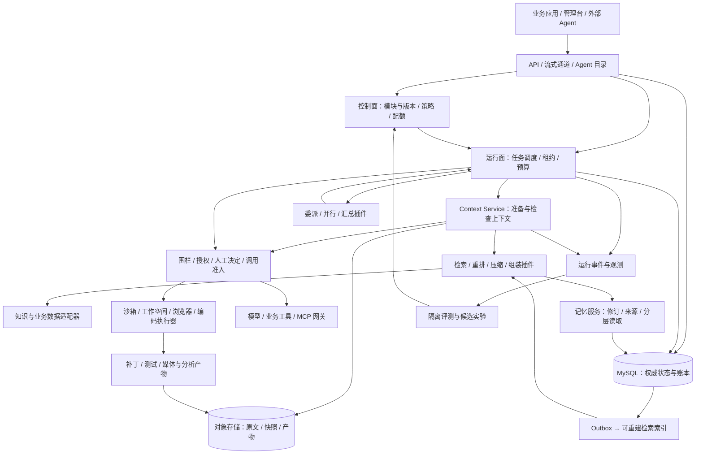
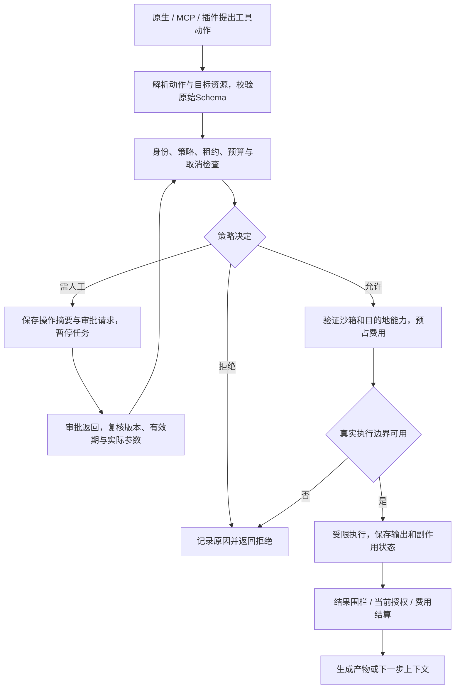
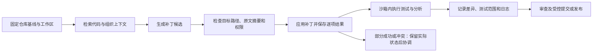
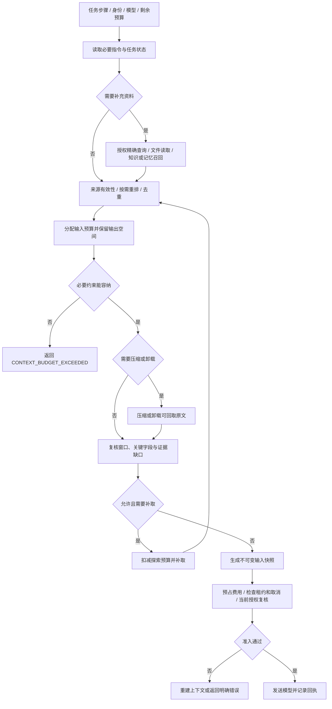
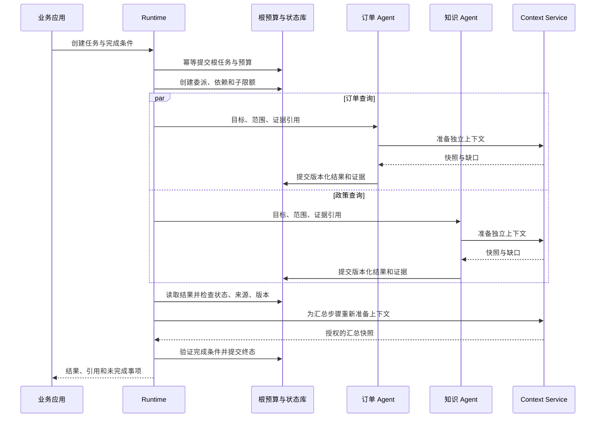
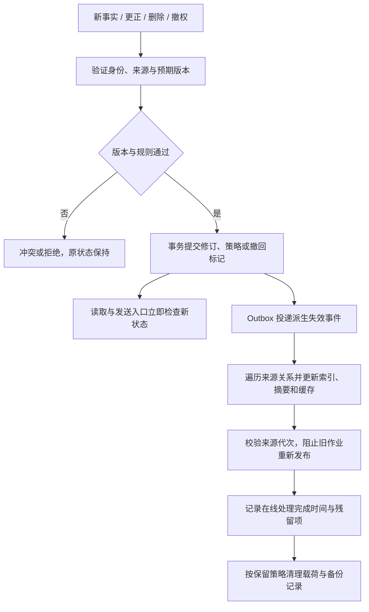
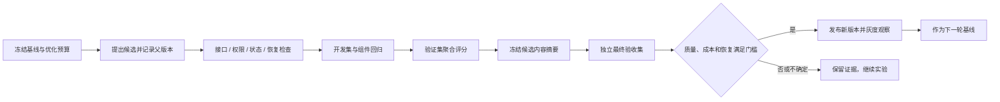

# AgentOS 技术设计

2026 年 11 月 17 日 · 设计基线草案 · 尚未实现

本设计把上下文管理作为所有受管模型调用的共同逻辑契约，把身份、预算、任务状态和发布版本作为运行约束。业务 Agent 通过能力 Profile 与模块组合复用中台能力。底层权威数据库按用户要求采用 MySQL，语言按团队已掌握的 Python 与 C++ 分工。当前只制定设计及实现规范，不生成应用代码。 [需求](../requirements/agentos-platform.md) · [运行契约](../specs/runtime-contracts.md) · [组件契约](../specs/component-contracts.md) · [验收](../specs/acceptance.md) · [任务计划](../plan/implementation-plan.md)

## 总体结构

首期采用模块化服务加独立 worker。API 负责身份、配置、任务受理与查询，worker 执行可恢复任务、上下文准备和后台作业。领域模块通过接口协作，存储和模型通过适配器接入。运行协议和模块边界先稳定，随后按吞吐和隔离需求拆分部署。

控制面管理身份策略、模块目录、发布组合、沙箱模板、协议连接与评测配置。运行面固定一个发布版本执行任务。数据层保存原文、派生内容、状态和来源关系。评测环境使用独立身份与数据权限，优化器提交候选，由评测器返回允许披露的结果。外部框架接入时记录登记、观测和强制执行的实际覆盖范围。

图中的框表示逻辑职责，不强制每框一个微服务。Context Service 初期是可嵌入 worker 的 Python 模块，检索/记忆适配器按数据位置部署。控制面的管理台或配置编辑服务中断，不应阻断已固定版本且权威准入仍可用的任务；授权、预算或取消的权威状态不可确认时继续失败关闭。不得用本地策略包的最终一致性替代严格撤权语义。[OPA部署取舍](https://www.openpolicyagent.org/docs/deploy) · [策略包更新边界](https://www.openpolicyagent.org/docs/management-bundles)

## 模块边界和可插拔接口

下表是进程内接口设计。HTTP 入口及公共错误语义以运行契约为准。接口实现不能直接扩大身份、修改根预算或绕过实际调用准入。可信内置插件可在 worker 内运行，第三方或自动生成代码放入独立进程或容器，通过受限 RPC 获取能力。

| 模块 | 核心接口与输出 | 内部可替换部分 | 必须保持的不变量 |
| --- | --- | --- | --- |
| Identity / Policy | `authorize(identity, operation, resources, destination)` → 决策与策略版本 | 企业身份源、资源策略适配 | 身份由可信入口派生，委派只能收窄 |
| Context Service | `prepare_context(request)` → 快照和缺口，`inspect_context` → 授权视图 | 选择、预算分配、压缩、组装 | 完整来源、必要约束、模型窗口和发送前复核 |
| Knowledge | `ingest`、`retrieve(query, scope, version)` → 来源片段 | 解析、切分、关键词和向量检索、重排 | 资源版本、ACL、段落位置、失效检查 |
| Memory | `propose_revision`、`commit_revision`、`read`、`retract` | 提取、合并、索引与存储适配 | 更正关系、有效时间、来源与冲突可见 |
| Model Gateway | `invoke(snapshot, reservation, limits)` → 响应和 usage | 供应商、模型路由、分词器 | 固定调用版本、实际输入摘要、费用上限能力声明 |
| Tool Gateway | `execute(operation, args, identity)` → 结果或未知状态 | MCP、本地函数、业务 API、沙箱 | 参数校验、操作 ID、授权、写操作效果声明 |
| Runtime | `submit`、`resume`、`cancel` → Task | Agent 循环、调度与等待策略 | 租约、状态机、预算和取消检查 |
| Collaboration | `plan`、`delegate`、`aggregate` → 任务图与结果 | 单 Agent、固定拓扑、动态协作 | 无环依赖、限定深度、结构化交接、CAS 合并 |
| Registry / Release | `validate_manifest`、`publish`、`select_release` | 插件分发、兼容检查、灰度策略 | 固定内容摘要、状态迁移与恢复证据 |
| Evaluation / Telemetry | `record_event`、`evaluate(candidate, config)` → 指标与证据 | trace 导出、判分、实验调度 | 不漏失败、不重复记费、留出集隔离 |
| Sandbox / Workspace | `provision`、`execute`、`checkpoint`、`restore`、`destroy` → 租约、结果、实际隔离证明 | 本地受限进程、容器、远程沙箱、浏览器会话 | 真实强制边界、资源上限、无静默降级、可追踪清理 |
| Guardrail / Human Decision | `evaluate`、`request_decision`、`resume` → 决定、理由与绑定摘要 | 规则、检测模型、人工审批和接管界面 | 硬拒绝优先、有效期、实际操作内容一致 |
| MCP Gateway | `discover`、`invoke`、`read_resource`、`get_prompt` → 版本化工具和结果 | stdio、HTTP及协议版本适配 | 原始Schema校验、独立凭证、企业授权与副作用去重 |
| Skill / Prompt Registry | `resolve`、`activate` → 固定版本及来源 | 技能格式、Prompt模板、渐进加载 | 资料或技能不能自行授予能力 |
| Channel / Agent Adapter | `submit`、`stream`、`interrupt`、`close` → 标准事件与产物 | HTTP、WebSocket、A2A、ACP、框架SDK | 能力匹配、事件顺序、背压、状态与取消映射 |

`prepare_context` 隐藏检索、记忆、预算与压缩的组合复杂度。检索器等内部接口仍可独立替换，业务开发者默认只选择组合配方。配置 Schema 同时规定可选参数及范围，避免业务团队必须理解所有内部组件。

M1 先提供一个真实模型适配器、固定上下文策略及契约夹具；基础平台完成前，模型、上下文、记忆各验证两个实现。模型可采用两个具备可验证预算上限的供应商；上下文比较固定规则与检索增强；记忆比较精确修订读取与精确读取加语义召回。共同接口与基础能力保持一致，语义召回属于额外声明能力，不能把增加功能或复制同一实现当成替换证明。其他基础模块均保留稳定接口、默认实现和验收，按 Profile 分批交付。

平台默认发布少数完整配方。三个模块各两种实现已形成8个基础组合，加入协议、沙箱和模态后不能承诺任意组合兼容。单组件完成契约测试，实际发布组合完成端到端与关键故障验证，认证绑定内容摘要和环境；交互组合按风险选择测试强度。[NIST组合测试边界](https://csrc.nist.gov/Projects/automated-combinatorial-testing-for-software/software-testing-methodology/dos-and-don-ts-of-testing)

## 能力 Profile 与跨类型支持

AgentProfile 组合模型、计划与循环、上下文、记忆、工具、技能、执行器、围栏、交互通道及评测模板。模型能力包括模态、工具调用、流式输出、结构化结果与窗口。执行能力包括文件、终端、代码、浏览器、桌面和远程业务动作。发布时计算所需能力与后端能力交集，缺失能力返回明确错误。

Session 保存多轮交互和跨任务关联，Task 保存一个目标的执行，Workspace 保存文件及进程资源，Memory 保存可供后续使用的信息，Artifact 保存产物。这些对象各有生命周期和保留策略，恢复会话不能直接宣称工作区和外部动作也已恢复。ADK Runner 和 OpenHands 的分层可作参考。[开源组件核查](../research/opensource-agent-components.md)

所有 Profile 共用授权、预算、上下文和审计语义。确定性工作流可跳过不必要的模型步骤，RAG 可作为独立服务调用，编码和数据分析通过沙箱执行，实时交互通过双向流承载，多 Agent 使用同一委派契约。跨框架适配器把外部事件转成标准事件，声明无法强制管控的环节。

Profile 按 planned、experimental、certified、unavailable 管理，只有指定版本和环境认证通过才进入生产路由。能力集合由代表业务场景预先冻结，认证失败不能通过删去必需能力变成通过。

运行时先做复用适配决策：优先核验 Python Agent runtime 的循环、图执行和中断能力，以及现有编码 harness；长业务流程确有需求时再比较独立工作流引擎。平台只持有自身领域状态和治理责任，不同时维护两套自动重试器。MySQL checkpoint适配、当前数据库版本兼容、状态映射、未知外部结果及升级恢复是选用门槛；框架宣称持久执行不能替代这些证据。[LangGraph持久化](https://docs.langchain.com/oss/python/langgraph/persistence) · [故障与重放语义](https://docs.langchain.com/oss/python/langgraph/fault-tolerance)

## 数据与存储

| 数据 | 建议存储与索引 | 所有权与一致性 |
| --- | --- | --- |
| AgentDefinition、AgentProfile、AgentVersion、PluginManifest | MySQL 元数据，对象存储保存包与摘要 | 发布版本不可变，活动版本指针可灰度切换 |
| Session、Task、Run、Delegation、Operation | MySQL，按租户与根任务索引 | 任务 version、attempt、lease_epoch 控制状态写入 |
| ContextItem、ContextSnapshot | MySQL清单与摘要，按retention_mode保存可选对象载荷 | 来源版本不可静默替换，留存副本与原输入摘要分开，访问按当前权限 |
| SourceRevision、MemoryRevision、MemoryTombstone | MySQL 修订、头指针与记忆级墓碑 | CAS 修改当前头，撤回覆盖全部历史修订 |
| DerivationEdge | MySQL 来源到摘要、片段、产物的关系 | 支持更新、删除、撤权的传递失效 |
| BudgetAccount、Reservation、DispatchAttempt、UsageReceipt | MySQL 金额、尝试与回执唯一键 | 每次发送预占和结算，业务幂等与计费去重分开 |
| TaskEvent、Outbox、Job、Trigger | MySQL 追加事件、待处理记录和触发去重键 | 业务状态、事件与 outbox 同事务提交 |
| ToolRecord、MCPConnection、Policy、Approval | MySQL 版本与凭证引用 | 原始Schema与模型适配Schema分别记录，秘密放密钥服务 |
| Workspace、SandboxLease、Checkpoint、Artifact | MySQL 生命周期与覆盖范围，对象存储产物 | 工作区独立租约，恢复检查实际捕获范围 |
| EvidenceLabel、EvaluationResult | MySQL 配置与汇总，对象存储样本和报告 | 按数据集划分独立权限，固定评分版本 |

数据库采用 InnoDB，拟以 MySQL 9.7 LTS 作为新部署候选，核心SQL保持8.4 LTS兼容，补丁版本在实际部署验证后锁定。运行时短事务显式使用 READ COMMITTED，预算和准入使用主库最新值、条件更新及行锁。worker 通过匹配索引的 `FOR UPDATE SKIP LOCKED` 领取队列表项，提交租约后再执行外部调用。SKIP LOCKED 只用于队列，不能用于跳过权限或预算检查。[版本策略](https://dev.mysql.com/doc/refman/9.7/en/mysql-releases.html) · [锁定读取](https://dev.mysql.com/doc/refman/8.4/en/innodb-locking-reads.html)

预算、操作唯一记录、任务变更、事件和Outbox在同一事务落库。锁序沿用运行契约，稳定策略头在准入时持共享锁、变更时取排他锁，业务调用期间不持有事务。死锁和锁超时均由应用整体回滚后有界重试，避免锁超时默认只回滚语句造成半提交。重复投递按操作去重，租约心跳使用数据库时间。主库不可用时受管新动作拒绝准入。[InnoDB错误语义](https://dev.mysql.com/doc/refman/8.4/en/innodb-error-handling.html)

租户、状态、版本、根任务、租约及队列时间使用独立列和复合索引，JSON用于扩展字段。语义输入按固定规范化规则计算摘要；正文按保留策略存对象，实际留存副本另有摘要。可选请求体字节证据单独保存，不能从MySQL JSON重新序列化后宣称字节相同。权限复核不能依赖延迟副本或旧事务快照。[JSON规范化](https://dev.mysql.com/doc/refman/8.4/en/json.html)

对象载荷先写不可变对象并计算摘要，再提交数据库引用。未成功引用的对象通过保留窗口后回收。删除走撤回标记、禁止读取、派生清理和载荷回收，记录各阶段状态。备份的保留与恢复流程必须重放删除标记，防止恢复后重新暴露已删除内容。

灾备依赖备份与异地binlog可覆盖的恢复水位。恢复期间关闭受保护读取与新调用，提升全局恢复代次，使旧租约失效。对日志缺口内的撤权、墓碑、费用和外部动作逐项核对，无法确认的范围保持隔离。重新验证对象引用和索引发布清单，RPO/RTO随实际部署拓扑确定并演练，不能以存在备份推定零数据损失。

检索默认候选采用 MySQL 权威状态加 OpenSearch 派生索引，集中承载词法与向量混合检索。MySQL ngram 全文检索作为可替换词法基线，MySQL全文加Qdrant作为备选组合。选择依据是中文业务效果、ACL过滤后的召回、索引新鲜度、延迟和运维成本，当前未完成性能优选。[MySQL ngram](https://dev.mysql.com/doc/refman/8.4/en/fulltext-search-ngram.html) · [OpenSearch混合检索](https://docs.opensearch.org/latest/vector-search/ai-search/hybrid-search/index/)

普通MySQL的VECTOR类型不等同于可用ANN索引，官方DISTANCE能力有HeatWave/MySQL AI产品限制，基础方案不依赖此能力。检索适配器记录源版本、租户、策略版本、嵌入模型、维度和索引代次，经Outbox幂等更新。索引只返回候选，送入重排或上下文前向MySQL复核当前授权和墓碑。过滤式ANN与精确回退分别测量，检索不可用时按Profile选择授权词法降级或明确失败。[向量产品边界](https://dev.mysql.com/doc/refman/9.7/en/vector-functions.html) · [过滤式检索](https://docs.opensearch.org/latest/vector-search/filter-search-knn/efficient-knn-filtering/)

## RAG 服务与协议接入

RAG同时提供内部上下文接口和独立服务入口。接入链为来源登记、解析、切分、嵌入、索引和发布，读取链为精确/词法/向量召回、授权复核、重排和证据解析。每一步可替换，返回来源版本、位置、得分、缺口、费用和索引新鲜度。代码符号检索、数据库查询和图谱检索是同一证据契约的不同实现。[组件契约](../specs/component-contracts.md)

平台MCP客户端接入外部工具、资源和Prompt，平台MCP服务端向获授权的外部Agent发布RAG、记忆或其他能力。两者共享工具登记、策略和账本。HTTP业务API、框架SDK、MCP与A2A分别适配到领域能力，协议本身不授予企业资源权限。

协议连接固定版本与能力快照。MCP 2026-07-28采用逐请求版本/能力与`server/discover`，旧2025-11-25路径保留独立初始化和会话兼容适配。不能把平台业务任务、数据库会话和MCP协议会话混为一个对象。只有实际兼容测试通过的组合才标为支持，详细传输和认证要求以固定版本规范为准。[MCP变更](https://modelcontextprotocol.io/specification/2026-07-28/changelog)

stdio服务器作为受控子进程启动，限制可执行文件、参数、工作目录、环境和网络。远程HTTP连接经出站代理及独立凭据范围访问。工具发现结果先登记，Schema或权限变化使旧审批失效。MCP原始Schema用于执行验证，模型可见的简化Schema只影响模型输入。资源及Prompt保持外部数据身份，sampling、elicitation等反向请求按独立能力、用户权限和预算准入。

## 沙箱、安全围栏与人工介入

围栏包括外部输入及上下文信任标签、敏感数据与目的地检查、模型输出Schema验证、工具参数与动作策略、结果投递检查。规则和检测模型都可替换，授权与预算硬约束由调用准入层强制执行。检测模型的风险判断不能覆盖确定性拒绝。

审批请求绑定操作ID、参数与内容摘要、资源版本、策略版本、审批主体及过期时间。重复答复以CAS处理，批准后重新鉴权和计费准入，操作变化需要新决定。无交互环境中需人工的动作保持可恢复等待或按Profile拒绝，不能自动解释为允许。恢复前的副作用仍需幂等。该设计借鉴LangGraph中断机制，并补上跨进程竞争和内容绑定。[中断与副作用](https://github.com/langchain-ai/docs/blob/main/src/oss/langgraph/interrupts.mdx)

SandboxProvider必须声明实际强制执行的文件读写根、保护路径、子进程树、网络、CPU、内存、磁盘、进程数和截止时间。Workspace绑定租户、项目、任务、镜像摘要、基线仓库版本和租约。目录归属不等于隔离，路径规范化、符号链接及挂载边界由执行器强制检查。沙箱不可用返回`SANDBOX_UNAVAILABLE`，禁止回退宿主执行。

生产候选采用独立执行池和容器沙箱，对运行不可信代码或多租户强隔离的Profile使用经验证的gVisor或microVM后端。普通容器、受限本地进程与强隔离后端分别记录能力，不声明等强保证。开发机可以选择本地适配器，但发布校验必须匹配环境的最低隔离要求。

按用户补充，优先验证腾讯云CubeSandbox v0.8.0作为Linux microVM后端，经Python SDK/HTTP封装SandboxProvider，复用代码/命令/文件、快照和暂停恢复。其内部Rust等组件无需在AgentOS重新实现。Windows工作站通过API使用独立Linux池；原生KVM与需定制宿主内核的PVM路径分别认证。当前仅核查文档和源码，未部署。[固定版本](https://github.com/TencentCloud/CubeSandbox/releases/tag/v0.8.0) · [专项核查](../research/language-and-requirements-review.md)

CubeSandbox的timeout是会被活动刷新的闲置TTL，不是绝对执行期限；适配器必须增加独立硬截止和取消代次，阻止晚到auto-resume复活任务。其默认公网和未配置回调时的API访问较宽，AgentOS须使用私有管理网络、有效鉴权和完整默认拒绝网络配置。网络更新是替换语义，不能把局部字段直接透传而恢复默认公网。[生命周期](https://github.com/TencentCloud/CubeSandbox/blob/v0.8.0/docs/guide/lifecycle.md) · [网络策略](https://github.com/TencentCloud/CubeSandbox/blob/v0.8.0/docs/guide/network-policy.md) · [管理面](https://github.com/TencentCloud/CubeSandbox/blob/v0.8.0/docs/guide/network-hardening.md)

full与fs-only快照、外部卷及跨节点条件分别记录。外部卷只保存挂载引用，clone可能共享可写数据；整机回滚不代替文件范围CAS恢复，不能回退MySQL的预算、取消、审批或墓碑。创建、fork和clone部分失败后由独立控制器按资源ID清理核对，SDK返回失败不证明没有孤儿资源。unknown状态不能映射为released，暂停也不代表无存储成本。[快照范围](https://github.com/TencentCloud/CubeSandbox/blob/v0.8.0/docs/guide/snapshot-rollback-clone.md) · [固定SDK](https://github.com/TencentCloud/CubeSandbox/blob/v0.8.0/sdk/python/cubesandbox/sandbox.py)

命令、MCP、浏览器、连接器、模型和重排分别经过各自出站控制，不能假定shell网络代理覆盖其他通道。禁止挂载宿主控制socket或平台数据库管理凭据，凭证按目标服务短期注入，模型只看到必要引用。任务结束、取消、超时和worker失联均触发资源回收，清理失败产生可见作业并限制新资源。[开源隔离边界核查](../research/opensource-agent-components.md)

## 编码、分析和浏览器执行

编码Profile组合仓库上下文、计划、文件工具、终端、测试与审查。代码索引包含仓库revision、文件hash、符号与位置，检索结果进入统一ContextSnapshot。仓库说明和技能只作为带信任标签的上下文，不能改变平台权限。工作区从固定基线创建隔离checkout或worktree，保留用户已有修改的归属。

补丁分生成、应用、验证、提交和推送阶段。应用前验证基线内容，返回逐文件/块的实际结果，重试不能重复应用已经完成的修改。测试记录环境、命令、退出码、用例范围、日志及测试文件是否被Agent修改。提交存在不等于验收通过。文件检查点只覆盖声明的文件，不能恢复数据库、进程或外部API动作。Aider的逐块编辑和OpenCode的快照边界为该契约提供直接参考。[开源编码Agent核查](../research/opensource-agent-components.md)

数据分析Profile复用沙箱执行与产物机制，SQL工具使用参数化查询、资源范围与只读角色，写入操作单独授权。浏览器和桌面Profile使用独立会话及受控凭据，截图、页面内容与下载文件进入产物及上下文来源链，实际点击或提交仍经过动作准入。

## 多模态、流式交互与持续运行

输入输出统一使用带类型的内容部分及产物引用，包含MIME、大小、摘要、时间段、来源和授权。图像、音频、视频可由原生多模态模型或转录/OCR适配器处理，派生文本保留原媒体位置与转换版本。模型路由按能力匹配，不能把不支持的媒体静默丢弃。

事件通道区分可丢弃的临时展示增量和必须持久化的工具决定、状态、产物完成事件。连接有序号、背压、缓冲上限和关闭原因。实时打断提升执行代次，旧增量可以停止展示，已发送外部请求进入取消及费用核对。需要出站内容扫描的Profile按可检查单元缓冲后发送，策略不支持实时放行时在发布校验中明确拒绝该组合。

事件、Webhook和定时触发以来源事件ID、计划版本与触发时隙去重。长驻Agent由多个有界任务组成，租户配额与预算周期约束总运行，后台心跳不无限延长截止时间。A2A/ACP或框架接入记录外部任务ID、能力和取消支持。外部终态必须映射到平台Task及副作用核对状态，不支持的能力显式返回错误。[A2A能力约定](https://github.com/a2aproject/A2A/blob/main/docs/specification.md) · [ADK Runner生命周期](https://github.com/google/adk-python/blob/main/docs/guides/runners/runner/index.md)

## 上下文准备与调用流程

每次模型调用都生成独立快照，包含网关外发语义输入摘要、来源与选择清单、消息/工具/输出格式版本及保留策略，调用记录绑定最终准入和供应商调用ID。正文允许完整留存、脱敏或仅保留元数据；完整内容审计和回放只覆盖仍有授权完整载荷的记录。传输字节诊断为可选能力，SDK最后一次语义改写必须可验证，不能以较早的消息对象冒充实际输入。普通trace默认不含正文，评测隔离使用获准完整记录。[OpenTelemetry内容捕获边界](https://github.com/open-telemetry/semantic-conventions-genai/blob/main/docs/gen-ai/client-inference.md)

以下流程按任务选择实际阶段：必要约束、任务状态和明确引用可直接组装，精确业务查询、文件按需读取和RAG各有适用路径。无证据检索需求时跳过召回与重排，窗口充足时跳过压缩。已有runtime的上下文策略可经认证适配点接入，不强制重复跑平台RAG。[上下文按需获取参考](https://www.anthropic.com/research/effective-context-engineering-for-ai-agents)

固定指令、用户约束、已经执行的动作、未完成事项和有效授权引用属于必保留项。摘要必须保留来源位置，原文可按授权回取。若压缩校验不通过，则回退原文或减少可选内容。预算不足时明确失败或调整任务范围。

P0 采用可解释的固定检索和压缩策略。P1 增加受预算约束的 evidence researcher，在 `open/search/browse` 能力内按当前问题补取证据。结果区分 `sufficient`、`budget_exhausted`、`missing_evidence`。`sufficient` 是策略判断，仍需评测真实证据覆盖率。最大轮次、费用、时间和循环检测共同约束补取过程。设计参考 ACM 和 JAM，组合效果由本项目实验验证。[论文调研 P01 与 P03](../research/arxiv-2026-h2.md)

P0研究类Profile使用固定、有界的多轮搜索/浏览与证据综合流程完成基础认证；P1自适应证据研究器单列增强能力。基础类型覆盖不以尚未交付的增强算法作为必需前置，也不把固定流程标成已经支持自适应补取。

原始日志、长期记忆和当前上下文分别管理。长期记忆提供后续可用信息，上下文是当前步骤实际需要的子集。动态订单状态等权威事实通过授权业务接口读取，并记录查询时点，避免将历史摘要当作当前业务状态。

## 多 Agent 调度与交接

首期支持单 Agent、协调者委派、并行执行和汇总。每个子任务拥有自己的工作上下文，父任务传递目标、完成条件和必要引用。成果存入各分支结果空间，依赖方按需读取。固定拓扑和动态拓扑共享同一运行契约。

调度器在创建依赖时拒绝环，记录等待原因、截止时间、并发和委派深度。父任务通过固定失败策略决定等待、替换失败分支或返回部分结果。部分结果是否成功由业务完成条件确定。不同分支修改共享数据时使用预期版本，冲突不能静默覆盖。

根预算统一统计全部子任务、工具、重试、压缩和异步记忆。每次调用先原子预占可执行的最大费用，收到回执后结算并释放差额。未知结果保留预占等待核对。子限额和根限额同时检查。调用次数、最大输出、并发、截止时间与费用共同控制开销。

业务operation_id标识同一逻辑动作，每次实际发送另有dispatch_attempt_id和独立费用预留。模型或只读工具失败重试即使属于同一操作，也必须累计所有已收费尝试，不能按operation_id去重费用。提供商回执按尝试和receipt_id幂等结算。

Task使用 `queued / running / waiting / cancelling / succeeded / failed / cancelled / timed_out`。恢复和重试保留原逻辑操作ID，旧租约不能继续提交。执行终态与费用 `pending / final` 分开。已成功任务的后台业务作业仅能在先前登记、已预留且预算有效的范围内收敛，资源清理等必要维护按独立通道规则继续。

取消父任务先提交取消标记，再阻止尚未准入的分支和调用。运行中外部请求尽力取消，迟到响应只进入核对记录，不能复活终态。外部写操作结果未知时进入查询或人工核对。数据恢复和业务补偿分别记录。

SAIGE 的实验显示协作收益因任务而异。因此系统保留同一上下文能力下的单 Agent 路径，动态协作先作为可选策略。评测使用相同根费用和截止时间，同时报告全部 Agent 的输入、输出与协调成本。[论文调研 P05](../research/arxiv-2026-h2.md)

## 记忆修订、遗忘和撤权

记忆包含 `candidate / active / superseded / retracted` 四种修订状态。精确事实更正更新头指针，语义提取可异步产生候选。冲突由来源、有效时间、确认状态与写入策略判断，无法消解时保留冲突供读取者处理。

事实种类、权威来源与时效规则随修订保存。业务系统观测、用户陈述、推断偏好、事件摘要和经验候选采用不同更新条件。MySQL只对平台记录负责；实时业务事实仍回查其系统，查不到时保留历史标记或未知状态，语义召回分数不能代替这一步。

派生内容继承依赖来源的访问约束。后台重建在提交时校验来源修订、策略版本和取消状态，旧工作不能重新发布已失效信息。索引清理可异步，读取入口以权威状态为准。在线更正和遗忘的传播时延从提交成功计到所有在线派生目标确认完成，失败目标保留可追踪状态。

索引使用不可变暂存代次，写入确认可见后再在MySQL按来源版本与墓碑条件CAS发布。旧作业即使迟到写入，也不能通过已失效的发布条件。资源释放、撤密钥、墓碑传播和删除清理走独立维护通道，在任务取消或业务预算耗尽后继续收敛，费用仍归因原任务。

最终DispatchAttempt准入事务与撤权在同一策略代次上串行化。预审批与提前预留不算最终准入。准入提交至网络发送的间隙属于已准入在途范围，无法与外部服务形成原子事务，重发必须重新准入。缓存键包含身份范围和策略版本。后续投递和读取检查当前授权，受保护产物通过鉴权代理提供，不发可绕过撤权的可复用对象存储直链。

快照元数据不可变，正文载荷遵守删除和保留规则。检查历史快照仍需当前授权。载荷被移除时保留摘要及不可用标记，完整输入重建返回 `SNAPSHOT_CONTENT_UNAVAILABLE`。使用相同输入重新执行也不保证相同模型输出。

## 插件发布、迁移与受控改进

插件清单声明接口主版本、输入输出及配置 Schema、请求能力、实现摘要、状态 Schema、可读取版本、迁移和恢复能力。AgentVersion 固定整套清单。新版本在新任务边界切换，旧任务按原版本恢复。

配置回退切换新任务的活动版本。状态恢复记录受影响范围和前后版本，按CAS检查当前状态。后续合法写入与恢复范围不重叠时可恢复，重叠时按明确的领域补偿保留新写入，无法安全合并则返回冲突并进入协调。不能整块覆盖快照而丢失合法变更。外部业务动作按领域补偿处理。

MySQL的atomic DDL不等于可随业务事务回滚的DDL。Schema变更采用兼容扩展、可重入数据迁移、校验、短事务切换版本指针、延后收缩的顺序。迁移失败保留旧读取格式和检查点，不能把DDL、数据搬迁及发布指针包装成一个可回滚事务。[MySQL Atomic DDL](https://dev.mysql.com/doc/refman/8.4/en/atomic-ddl.html)

P2 的 RSI 首先限定为模块、配置和组合的候选改进。优化器无法改写评测器、评分数据、授权服务或预算账本。候选在隔离执行环境内运行，开发集提供详细诊断，验证集提供约定聚合信息，最终验收集由独立执行者持有。候选生成、探测、选择和后台处理的费用全部计入优化预算。

采纳 PluginRSI 的插件与组合分别版本化思路，采纳 Harness² 的证据化经验条目。EvoUndo 的附录支持可直接恢复状态优先使用效果范围快照，其反事实恢复测试可用于迁移验收。自动生成恢复程序留作后续实验。[论文调研 P06 至 P10](../research/arxiv-2026-h2.md)

## 部署、观测与性能

建议使用 Python 建立主平台，FastAPI 作为 API 候选，独立worker执行任务，MySQL保存权威状态，S3兼容对象存储保存大载荷，检索层验证OpenSearch等适配器。首期先形成可测的 Python 实现，允许复用已有原生库；C++ 用于确有价值的本地集成或计算模块。管理台先提供必要审批和检查界面，Web前端技术栈在交互需求明确后选择，不增加第三套主后端。[语言取舍研究](../research/language-and-requirements-review.md)

| 责任 | 默认语言与接入方式 | 边界 |
| --- | --- | --- |
| 身份、任务、预算、MySQL事务、模块发布 | Python | 保持一套权威状态与重试语义，C++不另写账本 |
| 上下文、RAG策略、记忆、协作、评测、RSI | Python | 快速比较策略，复用研究实现和SDK；CPU计算不堵塞事件循环 |
| 模型/MCP/连接器与I/O调度 | Python异步worker | 有界并发、连接池、队列与取消；同步库移入适当执行池 |
| 可信批量计算热点、既有C++算法库 | C++可选，优先复用成熟库；必要时pybind11 | 明确所有权、GIL、数据复制、ABI及数值误差；不引入第二套业务状态 |
| 复杂解析、设备/OS集成、独立资源生命周期 | 独立C++进程或已有服务，经RPC/受控IPC | 按信任和故障边界隔离，外部动作继续使用准入和幂等契约 |

Python候选采用受支持的常规CPython构建，版本在依赖兼容验证后固定，不以free-threaded模式为前提。C++新模块建议C++20与固定CMake/编译器工具链，第三方库由隔离适配器处理兼容差异。pybind11为首个绑定候选，nanobind为备选，不同时维护两套绑定体系。进程边界已有HTTP可满足时不另造协议，确需高频双向通信时评估gRPC/Protobuf。[CPython free-threading](https://docs.python.org/3.14/howto/free-threading-python.html) · [gRPC语言接入](https://grpc.io/docs/languages/python/basics/)

释放GIL不意味着同步C++调用会让出所在asyncio事件循环。只有已验证长计算区间释放GIL且不访问Python对象的可信扩展，才可使用有界线程池；仍持GIL的计算放独立进程。需要单任务强制终止时使用独立可终止执行单元，共享线程池不能提供该保证。进程内绑定只容纳可信、可控的模块，所有权错误可能终止整个worker；不可信及RSI生成代码必须隔离。[pybind11 GIL](https://pybind11.readthedocs.io/en/stable/advanced/misc.html#global-interpreter-lock-gil) · [nanobind所有权](https://nanobind.readthedocs.io/en/latest/ownership.html)

自研C++候选进入开发前须有热点剖析和采用依据：现有库不能满足需求，计算或本地集成确实影响所选Profile的SLO，并预估维护成本；直接复用成熟原生库不要求先重做同类Python实现。验收计入序列化、复制、排队、构建发布和恢复，比较端到端延迟、CPU/内存、吞吐及费用；只改善微基准不能自动晋升默认实现。

开发环境可单机部署 API、worker、数据库及对象存储。试点环境使用独立 API 与 worker 实例、数据库备份、对象访问控制和独立评测执行环境。API 不承载长任务生命周期，任务持久化后由 worker 接续执行。FastAPI 官方也将需要跨进程或服务器执行的重型后台任务指向独立作业工具。[FastAPI 后台任务文档](https://fastapi.tiangolo.com/tutorial/background-tasks/)

通过 OpenTelemetry 兼容事件关联 `root_task_id / task_id / run_id / step_id / snapshot_id / operation_id / evaluation_id`。费用账本是计费权威来源，trace 提供诊断。默认日志记录元数据和受控内容引用，完整上下文检查使用资源授权。错误分为业务失败、运行失败、依赖失败和判分失败。

指标和门槛沿用需求文档。上下文 P95 延迟单独覆盖检索、重排、压缩和组装，冷缓存与热缓存分报。需要模型生成的压缩或研究步骤纳入完整时延，不能藏入后台成本。P0 优先预处理与可复用摘要，P1 补取策略单独报告质量、成本和延迟曲线。

性能实验固定模型、语料快照、100000 个片段、约32000 Token 历史、并发10及机器资源。报告队列时间和执行时间，按普通任务和复杂任务分层。超时、取消与失败进入分母。费用评测等待所有关联作业核对完毕。

## 首个纵向切片与待决项

首个切片使用只读售后场景完成任务创建、必要约束、一个真实授权证据路径、上下文快照、模型回答、引用和评测。完整混合检索、重排和独立RAG服务不作为这一切片的整体前置。随后按计划分别认证记忆与协作、编码工作区、MCP、RAG、业务审批、浏览器及多模态等组合。已验证能力可独立交付，平台整体完成仍以全部基础组件与类型矩阵验收为准。

实际业务场景、企业身份源、部署地域、外部模型的数据处理条件、采购预算和最终性能门槛需要在试点确定。MySQL已确定，检索后端、强隔离后端及框架复用程度按实验选择。每次行为设计更新后复核原始来源、替代方案、失败路径与验收映射，在[审核记录](review-log.md)保存结论。当前方案是在已知约束下的可检验建议，尚无依据声称跨所有场景全局最优。
