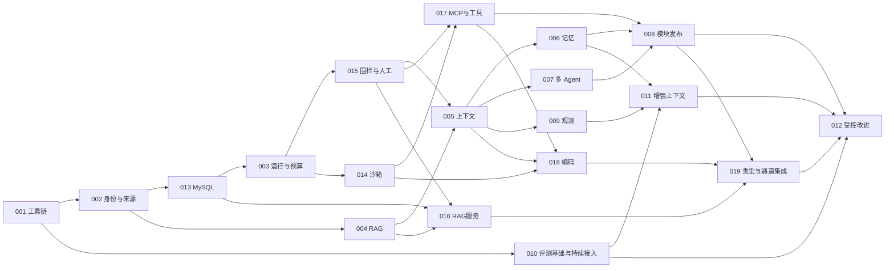

# AgentOS 实施计划

2026 年 11 月 18 日 · M1 首个只读任务已编写代码及测试，等待统一验证

本计划把需求、验收和研究建议连接到开发任务。M1 的实际实现范围、环境和待测项见[变更规格](../changes/m1-managed-support.md)。表中各 TASK 的整体验收仍待完成。底层数据库采用 MySQL。 [需求](../requirements/agentos-platform.md) · [技术设计](../design/technical-design.md) · [验收](../specs/acceptance.md) · [论文 P01–P10](../research/arxiv-2026-h2.md) · [开源组件核查](../research/opensource-agent-components.md)

团队已确认熟悉Python与C++。主平台按Python规划，C++仅在既有库集成或剖析证明有价值时进入对应任务，不要求每个模块有两套语言实现。P0表示基础能力优先级，任务可按下述里程碑交付可独立验收的子集；子集完成不把整项TASK或AC标为完成。完整依赖表用于整体完成，首个切片的具体前置子集在M1明确。

## 任务与依赖

| 编号 | 阶段与建议角色 | 交付物 | 前置依赖 | 需求与验收 |
| --- | --- | --- | --- | --- |
| TASK-001 | P0，平台工程 | 工具链、契约 Schema、文档检查与测试入口 | 无 | REQ-MOD-001、REQ-EVAL-001；AC-010、AC-014 |
| TASK-002 | P0，平台与身份工程 | 身份派生、资源策略、来源元数据与撤权检查 | TASK-001 | REQ-CTX-001、REQ-GOV-001；AC-001、AC-012 |
| TASK-003 | P0，运行时工程 | Task状态机、持久工作、租约、根预算和幂等 | TASK-001、TASK-002、TASK-013 | REQ-MA-002、REQ-MA-003、REQ-OPS-001；AC-008、AC-009、AC-028 |
| TASK-004 | P0，数据与检索工程 | 接入、修订、检索、重排和业务精确查询 | TASK-002、TASK-013 | REQ-RAG-001、REQ-CTX-002、REQ-GOV-001；AC-002、AC-005、AC-012 |
| TASK-005 | P0，上下文工程 | Context Service、输入快照、预算与压缩 | TASK-003、TASK-004、TASK-015 | REQ-CTX-001、REQ-CTX-002、REQ-CTX-003、REQ-OBS-001、REQ-GOV-001；AC-001、AC-002、AC-003、AC-012、AC-013 |
| TASK-006 | P0，记忆与数据工程 | 修订、分层读取、回取原文、遗忘和失效传播 | TASK-004、TASK-005 | REQ-MEM-001、REQ-CTX-003、REQ-GOV-001；AC-003、AC-006、AC-012 |
| TASK-007 | P0，协作运行时工程 | 委派、依赖、并行汇总、结果空间和取消传播 | TASK-003、TASK-005 | REQ-MA-001、REQ-MA-002、REQ-MA-003、REQ-GOV-001；AC-007、AC-008、AC-009、AC-012 |
| TASK-008 | P0，平台工程 | 插件目录、两种实现、组合发布、迁移和恢复 | TASK-005、TASK-006、TASK-007、TASK-014、TASK-017 | REQ-MOD-001、REQ-MOD-002、REQ-AGT-001；AC-010、AC-011、AC-018 |
| TASK-009 | P0，平台与前端工程 | 任务树、快照检查、费用核对与授权调试视图 | TASK-003、TASK-005 | REQ-OBS-001、REQ-CTX-004；AC-004的快照比较部分、AC-013 |
| TASK-010 | P0，评测工程与业务专家 | 数据划分、评分校准、对照实验和报告 | TASK-001，运行接入随其他任务完成 | REQ-EVAL-001、REQ-EVAL-002、REQ-MA-003；AC-009、AC-014、AC-015 |
| TASK-011 | P1，上下文与评测工程 | 有界证据研究器、阶段策略和泛化实验 | TASK-006、TASK-009、TASK-010 | REQ-CTX-004、REQ-CTX-002；AC-002、AC-004 |
| TASK-012 | P2，研究与平台工程 | 候选档案、隔离优化器、独立门禁与晋升 | TASK-008、TASK-010、TASK-011、TASK-019 | REQ-RSI-001、REQ-MOD-002、REQ-EVAL-002；AC-011、AC-015、AC-016 |
| TASK-013 | P0，数据与运行时工程 | MySQL事务、索引、Outbox、迁移与恢复规范落地 | TASK-001、TASK-002 | REQ-DATA-001；AC-017 |
| TASK-014 | P0，执行平台工程 | SandboxProvider、Workspace、资源租约和回收 | TASK-003 | REQ-EXE-001、REQ-OPS-001；AC-020、AC-028 |
| TASK-015 | P0，策略与交互工程 | 围栏、强制准入、审批与接管 | TASK-002、TASK-003 | REQ-GOV-002、REQ-HITL-001；AC-021、AC-025 |
| TASK-016 | P0，检索服务工程 | 独立RAG API及接入、检索、证据接口 | TASK-004、TASK-013、TASK-015；MCP暴露部分另依赖TASK-017 | REQ-RAG-002；AC-024 |
| TASK-017 | P0，工具与协议工程 | MCP双向网关、工具和技能目录 | TASK-003、TASK-014、TASK-015 | REQ-TOOL-001、REQ-TOOL-002；AC-022、AC-023 |
| TASK-018 | P0，编码执行工程 | 仓库上下文、补丁、测试、差异和发布适配 | TASK-005、TASK-014、TASK-015、TASK-017 | REQ-CODE-001；AC-026 |
| TASK-019 | P0，通道与集成工程 | 多模态、事件、长期任务、外部Agent与全部Profile验收 | TASK-007、TASK-008、TASK-014、TASK-015、TASK-016、TASK-017、TASK-018 | REQ-AGT-001、REQ-IO-001、REQ-INT-001、REQ-OPS-001；AC-018、AC-019、AC-027、AC-028 |

## 任务完成边界

### TASK-001 规范与工具链

确定依赖版本和开发环境，建立 API、worker、领域模块、适配器、测试和文档目录。将运行契约的核心对象落实为可验证 Schema，生成对应接口文档。加入链接、编号和 Schema 示例检查，固定实际可执行的测试命令。当前文档中的命令占位由本任务补齐。

先冻结Python版本、异步/进程边界与运行时复用决策。以现有框架适配和最小自建循环作比较，检查MySQL持久化、单一重试责任、取消及未知外部副作用；不默认自建完整工作流引擎。M1具备不可变组合清单与版本绑定，TASK-008后续补完整目录、灰度和替换认证。C++候选按需固定编译器、CMake、绑定或RPC协议，提交收益依据与跨语言契约，不预先铺设空服务。

本任务完成代表后续开发与测试入口可用，AC-010 的全部替换验证及 AC-014 的最终业务评测继续由后续任务完成。

### TASK-002 身份与来源

实现可信身份入口、委派权限收窄和资源策略判定。统一来源ID、版本、类型、有效时间、作用域及派生关系。先用两个租户和跨项目夹具通过授权模块契约，模型发送和跨Agent转发的完整撤权案例分别在TASK-005和TASK-007集成后完成。

### TASK-003 运行与预算

实现事务受理、outbox、worker租约、Task状态机、取消、超时与恢复。实现根预算原子预占和幂等结算，模拟未知外部结果与迟到回执。交付重启后可继续、不会重复执行已确认逻辑动作的最小运行时。

先按TASK-001的复用决策实现适配：MySQL负责平台状态，框架检查点只管理声明的内部状态，建立ID映射和核对。外部调用统一通过平台准入，不同时启用两套副作用重试。硬预算组合附可执行上界与故障证据。

### TASK-004 RAG 与业务查询

实现文档接入、结构化切分、关键词与向量召回、融合重排及精确业务查询。保存候选与最终采用来源，处理更新、删除和旧索引作业竞争。通过中文、表格、版本冲突和授权过滤案例。

M1只要求一个真实证据路径（如授权精确查询或固定语料词法检索）、来源版本、当前权限和删除检查。混合召回、重排与完整数据接入随后交付，未完成部分仍计入本任务。纯任务状态和直接引用不经过强制RAG流水线。

### TASK-005 上下文与首个完整任务

实现 `prepare_context`、窗口计算、必保留项、原文卸载、压缩校验和实际输入快照。接入模型与只读工具，完成售后问题从提交到证据回答的完整链路。原文回取借鉴 P01，先用固定策略，训练型方法进入后续实验。

M1使用TASK-004已验收证据子集和TASK-015的身份/输入/发送/投递硬约束子集，不等待全部RAG算法或完整人工接管UI。快照实现语义摘要、发送绑定及三种正文保留模式，完整回放与追踪分别报告；API和worker可调用同一上下文模块，不为纯计算步骤强制增加网络服务。

### TASK-006 记忆与遗忘

实现精确事实修订、确认状态、冲突、更正和撤回。增加原始历史、摘要和当前工作上下文的分层读取，异步提取和管理成本关联根任务。比较精确修订与语义增强后端，借鉴 P01、P02、P04。Fashion Mind 保留为待核验参考，接入前独立核验实际源码、许可证与行为。

### TASK-007 多 Agent

实现固定协调者加两个专业 Agent、独立上下文、任务依赖、结果按需取用和结构化交接。使用共享状态 CAS、循环检测和取消传播通过故障案例。动态拓扑作为实验策略，借鉴 P05 的依赖边界与按需成果读取。

### TASK-008 可插拔发布与恢复

落地插件清单、组合版本、模型/上下文/记忆各两个实现、契约测试与灰度指针。实现状态检查点、兼容迁移和范围恢复，验证后续合法变更不会丢失。参考 P04、P06 的稳定接口与组件档案，参考 P08 的效果范围和恢复测试。

### TASK-009 可检查的运行过程

实现授权的任务树、上下文输入与选择原因、快照差异、工具操作及费用视图。接入统一事件和费用核对，展示执行终态与费用未结算的区别。通过抽样回执核对和敏感日志权限案例。

### TASK-010 独立评测

先与业务专家建立任务分类和证据标签，再固定开发、验证及最终集的隔离方式。独立pilot用于估计任务簇方差与所需样本，冻结主要指标、功效、停止规则和可恢复故障类别；200×3只作规模参考。准备人工校准样本，落实失败分母、任务配对统计和费用最终结算。持续接入各模块，最终形成单 Agent、不同记忆和多 Agent 的统一报告。借鉴 P02、P09、P10，完整业务分布和策略敏感子集分别报告。

### TASK-011 增强上下文

以固定检索为基线，加入受限 `open/search/browse` 的证据研究器。定义充分、缺证据和预算耗尽结果，检验跨新用户、会话、文档和时间的泛化。采用 P03 的按需构造思路，先测试无需训练的实现，再决定是否引入训练流程。成本包含离线索引及在线探索。

### TASK-012 受控 RSI

实现候选差异、父版本、适用条件和证据档案，隔离优化器身份与计算预算。先实验一个模块，再比较组合变更。候选通过组件、端到端、独立留出及恢复门槛后形成可发布版本。参考 P04、P06、P07、P08、P09、P10，报告被淘汰候选与全部探测成本。

### TASK-013 MySQL与索引一致性

固定MySQL版本、InnoDB事务与查询索引。实现根预算、租约、事件与Outbox的一致性，处理提交未知、死锁和锁超时。分别验证语义摘要、留存载荷摘要和可选请求体字节摘要，以及主库授权、记忆级墓碑、索引重建和分阶段Schema迁移。对照OpenSearch与MySQL词法基线，保留Qdrant适配选项。权威数据始终在MySQL。

### TASK-014 沙箱与工作空间

实现沙箱能力声明、隔离工作区、受限执行、检查点、硬截止时间和资源回收。逐通道验证文件、进程、网络及凭据边界。参考Codex、Gemini CLI、OpenHands和DeepSeek Harness的执行接口，明确各后端实际能力，拒绝无法执行隔离策略的任务。

优先验证CubeSandbox v0.8.0的独立Linux执行池及Python适配，复用执行/文件/快照设施，补绝对deadline、完整网络策略、鉴权与清理核对。KVM/PVM、full/fs-only、外部卷和跨节点条件分别冻结，按AC-020/021/028验收后再认证；不继承闲置TTL、开放网络或SDK best-effort清理作为平台保证。与同等隔离能力候选比较端到端成本和故障结果。

### TASK-015 围栏与人工介入

实现输入、上下文、输出、动作及投递围栏，支持规则与检测器。人工决定绑定操作内容、资源和策略版本，持久化暂停后可恢复，审批重放和并发答复有确定语义。任何工具路径都经过强制准入，检测器与业务配置不能覆盖平台硬拒绝。

### TASK-016 独立RAG接口

把接入、解析、切分、嵌入、索引、检索、重排和证据解析落实为可替换接口及对外API。调用身份、配额和来源语义与内部Context Service一致。MCP封装由TASK-017接入，包含外部调用的权限收缩与版本兼容测试。

### TASK-017 MCP、工具与技能

实现客户端与对外服务器，分别验证2026-07-28和2025-11-25的所声明能力。统一动态工具、本地函数、HTTP和技能的登记、原始Schema、身份、准入和费用。凭据及出站策略按目标隔离，反向调用能力独立授权。不能继承开源CLI面向个人开发机的宽松默认值。

### TASK-018 编码Agent

实现仓库revision及符号上下文适配，隔离工作区、补丁应用、测试与差异审查。测试部分应用后重试、用户已有修改、测试被Agent修改、命令超时和恢复范围。生成、应用、测试、提交、推送权限分开，形成可审查产物。

### TASK-019 全类型与持续运行

完成类型矩阵的代表Profile及必需能力验收，覆盖多模态、浏览器/桌面、企业流程、数据分析和外部Agent。实现流式背压、打断、事件去重、定时及长任务预算周期，A2A/ACP或SDK按实际兼容能力接入。外部执行治理范围与不支持能力明确展示。

研究类基础Profile采用固定有界多轮流程，不依赖TASK-011的P1自适应研究器；后者就绪后按新增能力重新认证。

## 里程碑与检查点

TASK-009 与 TASK-017 的首批本地只读能力已进入实现，交付文本 Skill、词法检索 Tool、项目监控和任务时间线。可观察范围、接入示例和仍待验收的条目见[变更规格](../changes/capability-monitoring.md)。

TASK-009 的 M1 实例检查视图支持按 Agent 发布版本和运行尝试定位轨迹。补充的 AC-013 案例核对重领归属、运行窗口及观察权限。代码与配套测试待统一运行验收。[实例轨迹变更规格](../changes/agent-run-trace.md)

| 里程碑 | 可观察结果 | 进入下一阶段的依据 |
| --- | --- | --- |
| M1 首个受管任务 | TASK-001至TASK-005及TASK-013/015形成MySQL、授权、检索、上下文与回答链路，TASK-010有初始数据 | 完成快照、预算、证据和撤权的基础案例 |
| M2 记忆与协作 | TASK-006、TASK-007完成，TASK-009提供诊断 | 单与多 Agent 同预算对照、记忆更正及故障恢复有报告 |
| M3 通用组件与可替换平台 | 分批完成TASK-008及TASK-013至TASK-019全部P0组件，TASK-010覆盖完整类型矩阵 | 三类模块各两种实现，实际发布组合认证；全部类型、迁移恢复及量化验收有报告才宣布基础平台完成 |
| M4 上下文增强 | TASK-011完成 | 受预算补取的质量与总成本收益获得支持或明确不采用 |
| M5 候选改进实验 | TASK-012完成 | 留出隔离、可恢复性和候选收益可审计，是否晋升有证据 |

每个任务在实际开工时按[SDD规范](../specs/sdd-workflow.md)建立变更规格，记录实现范围、AC结果和证据。阶段指标未满足时记录原因和后续决定，不能将论文结果作为该任务已通过的依据。

M1交付的是上述任务所需子集：一个模型、一个真实证据路径、必要上下文、严格身份/预算准入、固定发布清单、基础观测与评测。安全契约不作删减，非该Profile所需的能力保持planned。M3内部建议按M3a（沙箱、工具/MCP、独立RAG、业务审批）、M3b（编码、数据分析、浏览器/桌面）、M3c（长任务、多模态、外部专业/设备适配与全矩阵汇总）逐组合认证；编号仅为交付批次，完整TASK/AC编号保持稳定。不同类型可并行，但发布只依赖自己的已认证能力集合，不等待无关类型。
