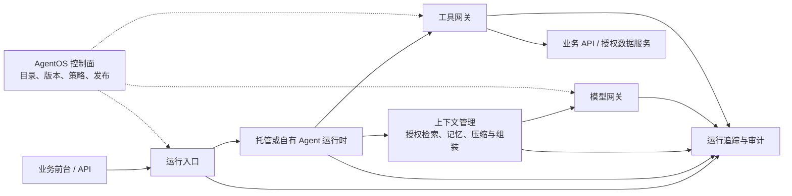

# 企业级 Agent 平台与中台建设调研

2026 年 11 月 16 日 · 已补充上下文管理、多 Agent 与量化评价

**初步判断**　AgentOS 以每次模型调用的上下文管理为核心，提供可插拔 Harness、多 Agent 协作和企业统一治理。共享能力覆盖知识检索、记忆、上下文组装、任务委派、权限、版本和评测，业务团队选择模块组合并对结果负责。递归自我改进（RSI）可以从优化上下文策略开始，用运行证据生成候选，以独立评测确认质量、成本和协作收益。需求与建议验收口径见需求草案。 [AgentOS 需求草案](../requirements/agentos-platform.md)

当前工作区没有现有实现或架构约定。本文假设 AgentOS 面向企业内部多业务团队，允许不同开发框架或运行时并存。厂商比较来自公开文档，尚未实测目标账号、地域、权限执行或数据导出，不能据此确认生产可用性。

## 大中台、小前台在 Agent 场景中的含义

阿里巴巴在 2023 财年年报中回顾了 2015 年启动的中台战略，描述了共享能力支持一线团队的组织模式，也记录了 2020 年起业务获得更大管理自主权的调整。CNCF 的平台工程白皮书把内部平台视为服务多个产品团队的自助产品，建议优先满足共性需求，复用外部托管服务或内部已有实现。套用到 AgentOS，可按跨团队需求沉淀能力，让各团队自助使用默认模块和策略。 [阿里巴巴 2023 财年年报](https://static.alibabagroup.com/reports/fy2023/ar/ebook/en/index.html) · [CNCF 平台白皮书](https://tag-app-delivery.cncf.io/whitepapers/platforms/)

| 层次 | 主要职责 | 例子 |
| --- | --- | --- |
| 业务前台 | 对用户体验、任务结果和业务流程负责 | 客服、采购、IT 服务各自设计交互、Prompt、业务流程和质量标准 |
| Agent 中台 | 提供跨团队治理与可组合的 Agent 基础能力 | Agent 目录、身份、工具、模型与记忆适配、默认 Harness、发布、评测和成本归集 |
| 业务中台 | 维护可复用的领域操作及业务约束 | 订单查询、工单创建由既有系统以 API 或工具提供，领域团队负责接口语义和业务权限 |
| 数据中台 | 维护数据口径、数据权限及授权数据服务 | 数据团队提供授权的检索或查询服务，Agent 继承数据访问范围。 [DataWorks 数据服务示例](https://help.aliyun.com/zh/dataworks/user-guide/getting-started-with-dataservice-studio) |
| 基础设施 | 提供计算、凭证与观测底座 | 现有 IdP、密钥服务、容器或托管运行时、日志与指标系统 |

平台团队维护目录、版本契约和策略执行入口。业务团队负责每个 Agent 的 owner、业务规则和评测样例。工具与数据 owner 决定资源可被谁、在什么条件下使用。安全和运维团队定义企业基线并维护审计与应急流程。

## 企业级平台对照

本轮选择海外托管和治理平台、国内云平台、可自托管的应用构建平台作对照。重点关注生产接入、策略执行位置、运行轨迹及集成限制。

### 海外平台

| 平台 | 文档明确的能力 | 对 AgentOS 的参考与验证项 |
| --- | --- | --- |
| **Microsoft Agent 365 / Microsoft Foundry** | Agent 365 已向商业客户正式发布，可从受支持的外部平台手动同步目录，外部遥测采集为预览。Foundry 支持托管 Agent，外部 Agent 注册为预览，通过 OpenTelemetry 和 Application Insights 接入观测与评测，调用及访问控制由原运行时和网关负责。 | 可参考跨平台目录和原有身份体系的整合。目录同步以读取为主，覆盖范围随来源变化，应分别验证资产发现、运行观测和停用路径。 [Agent 365 概述](https://learn.microsoft.com/en-us/microsoft-agent-365/overview) · [第三方平台接入](https://learn.microsoft.com/en-us/microsoft-agent-365/admin/connected-platforms) · [Foundry Agent Service](https://learn.microsoft.com/en-us/azure/foundry/agents/overview) · [Foundry 外部 Agent](https://learn.microsoft.com/en-us/azure/foundry/agents/how-to/register-external-agent) |
| **Google Cloud Gemini Enterprise Agent Platform** | Vertex AI 的演进产品。Agent Registry、Gateway、Observability 均已正式发布，结合 Agent Identity 和 IAM 对经网关的流量执行策略。网关接入 GKE 为预览，接入 Cloud Run 和 Google Cloud 外 Kubernetes 为有限预览。 | 可参考目录、工作负载身份与网关的联动。验证目标运行环境的流量方向、地域和代理部署要求，并确认 MCP 与 A2A 的可控范围。 [产品发布](https://cloud.google.com/blog/products/ai-machine-learning/introducing-gemini-enterprise-agent-platform) · [发布记录](https://docs.cloud.google.com/gemini-enterprise-agent-platform/release-notes) · [网关部署模式](https://docs.cloud.google.com/gemini-enterprise-agent-platform/govern/gateways/agent-gateway-overview) |
| **Amazon Bedrock AgentCore / AWS Agent Registry** | Runtime 支持多框架、多模型，Gateway、Identity、Memory、Observability、Evaluations 可独立接入。AgentCore Policy 与 AWS Agent Registry 已正式发布。AWS Organizations 自动发现覆盖成员账号中的 AgentCore Runtime 和 Gateway。 | 可参考将托管运行、工具网关和评测做成可独立选用的服务。验证策略是仅记录判定还是实际拦截，以及运行时能否限制为只接收网关转发。 [模块概述](https://docs.aws.amazon.com/bedrock-agentcore/latest/devguide/what-is-bedrock-agentcore.html) · [发布记录](https://docs.aws.amazon.com/bedrock-agentcore/latest/devguide/release-notes.html) · [策略模式](https://docs.aws.amazon.com/bedrock-agentcore/latest/devguide/policy-enforcement-modes.html) · [网关约束](https://docs.aws.amazon.com/bedrock-agentcore/latest/devguide/runtime-security-best-practices.html) |
| **OpenAI Frontier / ChatGPT Workspace Agents** | Frontier 提供共享业务上下文、Agent 身份和权限、执行、审计和评估，产品页提供销售接洽入口。Workspace Agents 处于研究预览，提供共享、定时、敏感操作审批和集中管理。开发者可选应用内运行的 Agents SDK 或托管 Codex 的 Agents API。 | 可参考共享业务上下文和敏感操作审批。采购前确认 Frontier 的可开通范围、外部 Agent 接入及审计导出条件。API Agent Builder 已公告于 2026 年 11 月 30 日下线。 [Frontier](https://openai.com/business/frontier/) · [Workspace Agents](https://openai.com/business/workspace-agents/) · [开发者运行方式](https://developers.openai.com/api/docs/guides/agents) · [弃用公告](https://developers.openai.com/api/docs/deprecations) |

### 国内平台与可自托管方案

| 平台 | 文档明确的能力 | 对 AgentOS 的参考与验证项 |
| --- | --- | --- |
| **阿里云 AgentRun** | 提供运行时、沙箱、模型治理、工具与凭证管理、观测。开放平台文档另列多层权限、Token 配额与 OIDC SSO。 | 适合对照企业统一身份和资源配额，以及高代码开发的接入方式。验证外部运行时的实际纳管范围，及目标地域所需模块。 [产品概述](https://help.aliyun.com/zh/agentrun/what-is-agentrun) · [开放平台](https://help.aliyun.com/zh/agentrun/open-platform-introduction) · [开服地域](https://help.aliyun.com/zh/agentrun/open-service-area) |
| **阿里云百炼 Agent Studio** | 提供应用构建和 MCP 接入。Managed Agents API 托管会话、沙箱、工具执行及事件流。Evolution 文档覆盖链路观测、版本效果对比、轨迹评测及生产 Trace 转评测集。 | 可参考业务自助构建和评测闭环。选型时分别核对 Agent 类型、评测入口和数据导出能力。 [Managed Agents](https://docs.agent.bailian.aliyun.com/zh/api/managed-agents/overview) · [MCP](https://docs.agent.bailian.aliyun.com/zh/mcp) · [Evolution](https://docs.agent.bailian.aliyun.com/zh/loop) |
| **火山引擎 AgentKit** | 支持用代码或镜像部署框架与模型无关的托管运行时，接入 MCP 网关，并提供观测和评测。运行时内置 IAM Role 控制云资源访问。 | 可参考高代码运行时、工具网关和观测的配合方式。发布记录按地域列功能，应核对目标地域的网关、评测及隔离能力。 [运行时](https://docs.volcengine.com/docs/agentkit/Agent_runtime_overview?lang=zh) · [产品概述](https://docs.volcengine.com/docs/agentkit/what-is-agentkit?lang=zh) · [发布记录](https://docs.volcengine.com/docs/agentkit/new-feature-release-notes?lang=zh) |
| **Dify** | 官方仓库列出可视化工作流、Agent、知识检索、模型集成与自托管。源码使用带额外条件的 Dify Open Source License。 | 可作为业务应用构建和发布的样本。若考虑以源码运行多租户服务，选型需核对该版本许可及企业版能力。 [官方仓库](https://github.com/langgenius/dify) · [许可证](https://github.com/langgenius/dify/blob/main/LICENSE) |

## AgentOS 的治理边界

**控制面**负责登记 Agent 与版本，管理负责人、环境、预算、策略、发布状态和可见范围。**执行面**负责运行 Agent。模型和工具调用可由网关执行策略，也可由运行时内经过验证的机制执行等效策略。目录里可以展示其纳管程度，例如“已登记”“已上报运行数据”“已验证可执行调用策略”，并按模型、工具、数据入口分别标明范围。

Microsoft Foundry 的新外部 Agent 接入适合观测和评测，调用仍由原有入口承接。Google 的跨云网关在集群里执行策略，要求接入方将流量路由到本地代理。AWS AgentCore 又区分仅记录决策和实际拦截两种网关模式。这些差异应落实到选型验收，逐条测出哪些调用会被拒绝。 [Foundry 外部 Agent](https://learn.microsoft.com/en-us/azure/foundry/agents/how-to/register-external-agent) · [Google 跨云网关](https://docs.cloud.google.com/gemini-enterprise-agent-platform/agents/governance/agent-gateway-cross-cloud/overview) · [AWS 网关执行模式](https://docs.aws.amazon.com/bedrock-agentcore/latest/devguide/policy-enforcement-modes.html)

### 优先建设的共享能力

| 优先级 | 能力 | 统一管理到什么程度 |
| --- | --- | --- |
| P0 | 上下文管理与知识接入 | 为每次调用记录资料与状态版本，按角色授权检索、重排、压缩和组装，控制 Token 预算，保留证据及选取原因。 |
| P0 | 多 Agent 基础协作 | 委派任务和预算，隔离工作上下文，支持并行和成果汇总、共享状态版本、取消与失败恢复，并统一追踪父子任务。 |
| P0 | Agent 目录与版本 | 为每个 Agent 分配稳定 ID，记录所属团队、负责人、用途、环境、运行入口和依赖。发布记录绑定可定位的代码或配置版本，以及 Prompt、模型策略和工具授权的引用。 |
| P0 | 身份与工具治理 | 区分发起人、Agent 服务身份和下游委托身份。网关按租户、Agent、操作和资源范围授权，凭证通过运行时或网关获取。授权工具也应由业务服务做资源级鉴权。 |
| P0 | 运行观测、审计与用量 | 关联每次运行、模型用量、工具调用、策略判定及最终结果，按团队和 Agent 版本归集用量。审计记录保留主体、操作、决策和关联 ID，追踪数据默认只采集排障所需字段。 |
| P0 | 发布、评测与停用 | 业务团队维护小规模回归集，平台记录结果并把通过条件用于发布。支持将新流量切回已知版本和在已受控入口撤销调用权限，同时验证正在执行的任务会如何处理。 |
| P1 | 模型网关扩展 | 在已有模型接入能力上扩展路由、配额和用量统计，优先复用已有网关。 |
| P1 | 写操作审批与任务恢复 | 针对业务写操作，把审批绑定到操作者、目标资源、具体动作和参数。验证重复提交的幂等性、超时和恢复语义，复用现有审批与任务系统。 |
| 按需求扩展 | 跨平台协议与额外运行时能力 | 按业务需求接入跨平台任务协议、长任务调度和额外的沙箱后端。长期记忆先验证一个有跨会话需求的场景。 |

如果首个场景包含写操作，审批、幂等性和业务系统鉴权随该场景进入首期。身份、日志及工具响应可能跨不同系统，试点应明确字段脱敏、权限和保留期限。用量统计还应标注覆盖范围，区分真实账单与按 Token 或调用量估算的成本。

### 互操作标准及其边界

- **MCP** 适合作为 Agent 接入工具、资源和提示词的一种协议。远程接入应明确客户端与服务端支持的规范版本，为每个工具另设业务授权和审计策略。不同 SDK 和厂商接入的版本应通过兼容性测试确认。 [MCP 2026-07-28 规范](https://modelcontextprotocol.io/specification/2026-07-28) · [授权规范](https://modelcontextprotocol.io/specification/2026-07-28/basic/authorization)
- **A2A** 提供 Agent Card、消息、任务和产物等跨 Agent 交互约定。规范将任务可见范围交给实现方的授权模型。首期可以先用现有 API 接入，跨组织或跨运行时任务委托明确后再引入 A2A。 [A2A 1.0 规范](https://a2a-protocol.org/v1.0.0/specification/) · [版本记录](https://github.com/a2aproject/A2A/releases)
- **OpenTelemetry** 可用来关联运行、模型与工具调用。GenAI Agent span 约定已迁到独立仓库，当前标为 Development。建议用 OTel 接入观测数据，并为 AgentOS 审计字段维护独立版本。 [Agent span 语义约定](https://github.com/open-telemetry/semantic-conventions-genai/blob/main/docs/gen-ai/gen-ai-agent-spans.md) · [GenAI 语义约定迁移记录](https://github.com/open-telemetry/semantic-conventions/releases)

## 可插拔 Agent Harness

Harness 是围绕模型运行 Agent 的代码和配置，包括调用循环、上下文组装、工具调度、状态持久化和恢复。DeepSeek Harness 把模型适配器、工具注册表、会话日志和 Agent 循环都做成 Cordis 插件。一个可替换能力由接口定义、实现和调用方构成。Profile 组合多个 bundle，并用有顺序的 patch 覆盖配置。部分 CLI 配置支持重载，headless、SDK 和 ACP 默认关闭这项能力。LangChain Deep Agents 的 Python beta Harness Profile 可按模型覆盖 Prompt、工具描述、中间件和子 Agent 配置。AgentOS 可参考 DeepSeek 的完整运行时组装方式，以及 Deep Agents 的按模型调优方式。 [DeepSeek Harness 架构](https://github.com/deepseek-ai/deepseek-harness/blob/master/docs/architecture.md) · [DeepSeek Harness SDK](https://github.com/deepseek-ai/deepseek-harness/blob/master/packages/sdk/README.md) · [LangChain Deep Agents Profiles](https://docs.langchain.com/oss/python/deepagents/profiles)

### 建议的模块边界

| 模块 | 可替换的实现 | 应保持的契约 |
| --- | --- | --- |
| 模型与路由 | 模型提供商、路由算法、降级策略 | 流式输出、结构化输出、工具调用与用量口径，声明模型能力差异 |
| Agent 循环与编排 | 单 Agent 循环、显式工作流、任务委派 | 运行状态、取消、恢复、事件和统一工具调用入口 |
| 上下文与指令 | Prompt、上下文拼装、压缩器、技能选择 | 消息和资料来源、上下文预算、保留业务指令与审批状态 |
| 工具与技能 | MCP、既有 API、业务技能包、本地执行后端 | 输入输出 Schema、操作分类、授权主体、超时和写操作幂等 |
| 会话与记忆 | 会话存储、记忆提取器、检索器、SQL 或托管记忆服务 | 状态 Schema、范围隔离、数据来源、删除和迁移 |
| 执行与审批 | 沙箱后端、人工审批系统、运行适配器 | 访问范围、审批凭据、任务恢复语义和审计事件 |
| 观测与评测 | Trace 导出器、规则判分器、人工和模型评估器 | 统一运行 ID，指标、评测集及评估器版本，发布门槛归控制面管理 |

**配置组合与版本。** 一个发布版本固定所用 Profile、模块版本、Prompt 和技能版本与状态 Schema，并关联企业策略。新运行可以选择新组合，正在执行的任务沿用启动时的组合，权限撤销仍在调用时生效。持久化模块切换需验证旧会话能继续读取，或通过显式迁移恢复。Loop 也可以替换，前提是它遵守相同的运行生命周期、事件和授权入口。配置类模块与可执行插件走各自的验证，第三方可执行插件可部署在独立进程或沙箱中，仅获得声明并获批的能力。

### Fashion Mind 对记忆模块的启发

Fashion Mind 短链被第三方课程索引关联到 Google Cloud Tech 个性化造型 Agent 视频。2026年11月17日复核仍未取得短链重定向、官方视频正文或源码，因此保留为待核验线索，尚未审阅或运行其记忆实现。以下设计另参考 Google Cloud 的 Memory Bank 技术文档，借鉴结构化事实和语义记忆各自的读写语义。当前访问失败不能用于判断短链已经失效。 [Fashion Mind 短链](https://g.dev/ai/fashion-mind) · [关联视频线索](https://youtu.be/8C4bh59FtsI) · [Memory Bank 技术文档](https://docs.cloud.google.com/gemini-enterprise-agent-platform/scale/memory-bank)

| 记忆能力 | 在 AgentOS 中的用法 |
| --- | --- |
| 会话状态 | 保持当前对话和任务进度，用于恢复。会话事件按需生成跨会话记忆。 |
| 结构化事实 | 按键读写用户明确确认的偏好或设置，保留来源、确认状态和修订版本。订单状态等权威实时事实始终查询源系统。 |
| 语义记忆 | 从历史对话或任务中提炼经验和偏好，按作用域做相似检索。通过后台任务提取和合并，给条目记录证据、版本和保留期。 |

建议把精确查询、语义检索和记忆写入策略暴露为可独立替换的能力。SQL 与向量检索可以由同一基础设施承载，也可接入现有存储或托管 Memory Bank。对用户明确要求保存、且通过写入策略的事实，可直接确认写入。推断出的偏好适合后台归纳，并保留来源与撤销路径。记忆服务应验证调用者身份，将租户、用户或项目作用域带入检索、写入及删除，并使删除或纠正同步到派生索引。可用同一个业务场景比较无长期记忆、仅结构化记忆、再加入语义记忆的质量和延迟。 [Memory Bank 的生成机制](https://docs.cloud.google.com/gemini-enterprise-agent-platform/scale/memory-bank/generate-memories?hl=en) · [按作用域配置 IAM](https://docs.cloud.google.com/gemini-enterprise-agent-platform/scale/memory-bank/iam-conditions)

## RSI 研究与企业落地

本节将普通的跨会话记忆视作运行数据的积累。Harness 优化改变后续运行的模块或配置。研究中的递归深度还取决于候选由谁生成、获选版本如何参与下一轮，以及改进机制本身是否可修改。下表将各论文的实验机制与可在 AgentOS 中验证的做法对应起来。

| 研究 | 优化对象与机制 | 对 AgentOS 的启发 |
| --- | --- | --- |
| **Meta-Harness（2026）** | 外部优化 Agent 读取候选版本的代码、得分和执行轨迹，为固定模型搜索新的 Harness。论文给出了多个基准的结果。 | 先把失败轨迹、版本差异和评测结果关联起来，支持离线生成和比较候选版本。 [论文](https://arxiv.org/html/2603.28052v1) |
| **PluginRSI（2026 年 10 月修订）** | 预印本将 Harness 拆为可重组的插件。提案 Agent 分别修改插件实现、评测并积累到共享库，再更新插件组合和调用流程。论文验证了部分跨模型复用，也报告跨域收益有差异。 | 把插件和组合方案分别版本化，既评估单模块变更，也对组合做整体验收。 [论文](https://arxiv.org/html/2609.32423v2) |
| **Self-Harness（2026）** | 同一冻结模型在当前 Harness 下，依据失败轨迹为声明的配置点提出有界变更。候选经回归测试后才进入下一轮，提案过程无法读取留出样例。 | 可先试验检索排序、工具选择顺序和重试参数的有界优化，固定模型版本与预算，用独立评测验证。 [论文](https://arxiv.org/html/2606.09498v3) |
| **Darwin Gödel Machine（ICLR 2026）和 Hyperagents（2026 年 11 月修订）** | DGM 允许编码 Agent 改写自身代码，用基准验证并归档变体，外层探索流程固定。Hyperagents 将任务 Agent 和元 Agent 合在可编辑程序内，元 Agent 可同时改变任务逻辑和后续改进方式。 | 优化器本身的自修改适合在隔离环境研究，生产发布、评测门禁和权限仍由独立组件执行。 [DGM 会议论文](https://openreview.net/pdf?id=pUpzQZTvGY) · [Hyperagents 论文](https://arxiv.org/abs/2603.19461) |
| **Harness²（Google Cloud AI Research 与 Northwestern，2026 年 10 月）** | 预印本研究两层递归。任务层用执行结果的对比来修改当前 Harness，修改时无需标准答案。改进层积累可复用组件和经验，供以后任务使用。论文记录了额外推理成本及候选误选造成的效果下降。 | 可在试验环境用任务临时覆盖来验证新策略。跨任务复用的变更应独立评测并经过发布流程。 [论文](https://arxiv.org/html/2610.14224v1) |
| **EvoUndo（2026）** | 预印本用独立验证器在多种初始状态上执行变更与恢复，检查声明范围内的状态能否复原。实验显示，扩大验证覆盖可减少观察到的误放行，也会错拒部分可恢复候选。 | 将切回 Harness 版本和恢复业务副作用作为两个验收项。插件若持久化状态，应记录影响范围并实际演练恢复。 [论文](https://arxiv.org/html/2608.28363v2) |

第一阶段可以固定模型版本与试验预算，把经过筛选的失败轨迹交给独立的优化 Agent，对 Prompt、技能示例、上下文压缩或记忆提取策略生成单模块候选。每个候选记录父版本、改动、优化器版本和证据。在隔离环境用开发集筛选，再由独立评测使用未暴露的留出集对比任务通过率、工具调用正确性、权限合规、成本和延迟。发布环节从通过评测的候选中选出版本做灰度，效果稳定后可把该版本作为下一轮基线。涉及持久状态的模块还需分别验证版本回退和数据恢复。业务工具的实际写入按领域规则处理补偿。

## 先验证的落地方案

建议用一个结合文档、结构化查询与记忆的只读业务场景，分别实现单 Agent 和委派式多 Agent。二者使用相同的上下文基础能力，以同一任务集和总预算比较。可从售后政策与订单综合查询入手，验证检索、压缩、交接、授权和恢复。已有 IdP、API 网关、密钥管理或观测服务可继续作为平台组件。跨框架接入随企业现有 Agent 的分布确定。

| 验证项 | 通过条件示例 |
| --- | --- |
| 上下文质量 | 能定位必要证据在哪个阶段被遗漏，并检查压缩和交接前后用户约束、任务状态与来源是否保留。 |
| 多 Agent 协作 | 能执行两个独立子任务并汇总证据，处理子任务超时和共享状态冲突，同预算比较任务成功率与费用。 |
| 模块替换 | 业务调用方式保持一致，分别替换模型适配器与一个会话或记忆实现。新运行命中指定模块版本，已有会话通过兼容读取或显式迁移恢复。 |
| 自助接入 | 两个团队能按同一契约登记、部署或关联已有端点，并查到负责人、版本和授权工具。记录从申请到首个受管运行的时间。 |
| 权限执行 | 有权请求成功，跨团队或越权的业务请求被拒绝，审计可查到明确的拒绝原因。停用后，在约定时限内经受管路径发出的新请求被拒绝。 |
| 可追溯与用量 | 任选一次运行，可关联发起主体、版本、实际工具调用和用量。验证业务日志、追踪和审计对敏感字段的处理。 |
| 版本回退 | 可用固定样例跑发布前回归。回退后，新流量指向指定版本，既往运行仍能查到原版本。 |
| 跨平台治理覆盖 | 同一条策略在两个运行方式中均能触发授权与拒绝，能够明确指出外部托管调用中哪些路径仅能在目录登记或观测。 |
| 优化候选 | 在固定模型下用同一批留出任务对照基线和单模块候选。能复查差异，能识别只提升开发集成绩的候选，并能回退应用版本及核对记忆数据影响。 |

**采购和自建的初步取舍**　若业务已集中在一个云生态，可以先验证该云的原生治理与运行时，比较接入成本和交付速度。若企业已有多套运行时，优先验证 AgentOS 的统一治理层加少量适配器，复用厂商执行和观测组件。若确有私有网络部署或数据驻留要求，再按目标环境考察自托管方案，并实际验证身份透传、审计出口、运维成本和升级路径。

下一轮需要明确首批场景及写操作范围、现有身份和网关资产、允许部署的位置及数据边界、需要纳管的现有 Agent。用这些信息选出两种候选部署方式做试点，再决定平台自建范围和供应商。

## 多 Agent 协作与上下文交接调研

2026 年 11 月 16 日补充。多 Agent 的产品设计需要同时定义谁负责执行、每个 Agent 可见哪些信息，以及子任务结果如何合入后续上下文。LangChain 将上下文管理、团队独立开发和并行执行列为采用多 Agent 的主要原因。AgentOS 可以把任务委派和上下文分配组合成统一能力，允许业务团队选择不同编排方式。 [LangChain 多 Agent 概述](https://docs.langchain.com/oss/python/langchain/multi-agent)

| 调研结论 | 一手资料中的依据 | 对 AgentOS 的建设要求 |
| --- | --- | --- |
| 委派和交接需要明确控制权 | LangChain 的 subagent 由主 Agent 调用并回收结果。Handoff 通过持久状态变更，让后续消息由新的 Agent 或配置承接。 | 支持主 Agent 调用子 Agent、并行任务后汇总、按条件交接三种模式。委派请求含任务目标、输出契约、完成条件、权限和预算。交接额外记录当前责任人、待办事项及恢复位置。 [Subagents](https://docs.langchain.com/oss/python/langchain/multi-agent/subagents) · [Handoffs](https://docs.langchain.com/oss/python/langchain/multi-agent/handoffs) |
| 子 Agent 的输入与返回是上下文管理的两个入口 | LangChain 提供隔离输入和继承历史两种方式。Anthropic 的研究系统使用独立上下文开展探索，再把结果交给主 Agent 汇总，并强调委派目标和边界要清晰。 | 每次委派显式选择所需历史、事实和资料，记录发给子 Agent 的上下文版本。子 Agent 返回结构化结论、证据引用、产物位置、未解决问题与状态。主 Agent 按需取回原始证据，汇总结果可追溯到来源。 [Subagent 上下文配置](https://docs.langchain.com/oss/python/langchain/multi-agent/subagents) · [Anthropic 多 Agent 研究系统](https://www.anthropic.com/research/multi-agent-research-system) |
| 并行执行需要独立的状态合并规则 | Google ADK 并行模板的各分支具有各自事件历史，同时共享会话状态，官方要求显式处理共享结果与读取时机。当前 Python、TypeScript、Go 和 Kotlin 的模板工作流已转向 graph 和 dynamic workflows。 | 子任务使用独立输出空间，通过完成事件提交结果。汇总时检查版本、冲突和缺失项。重试需要去重，取消应传递给仍在运行的分支。编排插件必须暴露依赖关系、完成状态和结果合并方式。 [ADK 并行执行与状态管理](https://adk.dev/agents/workflow-agents/parallel-agents/) |
| 共享记忆需要覆盖读取、传播和更正 | 2026 年预印本 Governed Shared Memory 在一个实际服务中检查作用域、时效、来源和传播，记录了按 ID 读取绕过子作用域、去重流程阻止矛盾更新等问题。该研究提供单一服务的案例证据。 | 定义 Agent 私有、任务共享和项目共享范围。检索、按 ID 读取、结果转发及缓存命中执行同一授权语义。记忆保留写入者、来源、有效时间和替代关系，更正与删除能传播到派生摘要和索引。 [Governed Shared Memory](https://arxiv.org/abs/2606.24535) |
| 失败诊断需要覆盖任务分解、协调和验收 | MAST 研究从多 Agent 执行轨迹归纳了系统设计、Agent 间失配和任务验证三类问题。Anthropic 的工程记录也出现重复搜索、任务边界不清和已完成后继续运行等现象。 | 记录任务树和交接事件，能定位遗漏依赖、重复执行、结果冲突、错误完成及循环。完成判断关联可检查的交付物或业务状态，支持超时、局部重试、暂停恢复与人工接续。 [MAST 研究](https://arxiv.org/abs/2503.13657) · [Anthropic 工程记录](https://www.anthropic.com/research/multi-agent-research-system) |
| 多 Agent 收益需要在相同预算下测量 | 2026 年预印本 Phase Transition for Budgeted Multi-Agent Synergy 在受限模型中分析上下文容量、通信损失及相关错误对协同收益的影响，并以合成实验验证。Anthropic 也记录了其研究系统的明显 Token 开销。 | 在相同模型池、工具、知识快照和总预算下比较单 Agent 与多 Agent。汇总全部分支的费用、Token 和工具调用，报告任务成功率、时延、交接信息保留和重复工作。单 Agent 执行也应是编排器可选择的路径。 [预算约束下的多 Agent 理论研究](https://arxiv.org/abs/2601.17311) · [Anthropic 多 Agent 系统成本经验](https://www.anthropic.com/research/multi-agent-research-system) |

建议首个多 Agent 场景采用有清晰资料边界的并行调查，例如一个 Agent 查询业务规则，另一个查询订单状态，由主 Agent 汇总。为每个子任务保存所见上下文、来源引用和输出产物，向评测集加入资料缺失、证据冲突、子任务超时、并发写入、授权撤销以及用户中途修改目标等用例。通过这些用例同时验证协作能力和上下文管理。

## 上下文管理与 RAG 调研

上下文管理涵盖每次模型调用的指令、工具定义、任务状态、历史和外部信息。LangChain 官方文档区分模型输入、工具可访问状态和调用间生命周期处理。Anthropic 的工程文章讨论按需读取、压缩、持久化笔记和子 Agent 上下文。AgentOS 可以把这些能力放进统一的上下文流程，各环节提供可替换实现，并保留输入快照和选择理由。 [LangChain 上下文工程](https://docs.langchain.com/oss/python/langchain/context-engineering) · [Anthropic 上下文工程](https://www.anthropic.com/research/effective-context-engineering-for-ai-agents)

| 研究或实践 | 核验到的做法 | 对 AgentOS 的启发 |
| --- | --- | --- |
| Contextual Retrieval | 为文档片段增加相关背景，结合语义与 BM25 检索并重排。作者在其数据上报告检索失败率改善，也讨论重排的耗时和成本。 | 保留文档结构和来源，提供精确查询、混合检索、重排等可替换策略。参数和收益由业务语料验证。 [官方工程文章](https://www.anthropic.com/research/contextual-retrieval) |
| Lost in the Middle | 原始研究发现所测模型使用长上下文的表现随相关信息的位置变化，中间位置的信息较难被利用。 | 测试必要证据在开头、中间、末尾的表现，以及干扰内容增加时的质量变化，当前模型单独复测。 [论文](https://arxiv.org/abs/2307.03172) |
| Agentic Context Engineering | ACE 将上下文作为可积累的策略记录，通过生成、反思和整理逐步更新，研究反复重写造成的细节丢失。论文于2026年修订并标注 ICLR 2026。 | 上下文策略和经验保留条目级变更、来源和版本，建立策略变更到任务效果的对照，也为 RSI 提供可限定的优化对象。 [ACE 论文](https://arxiv.org/abs/2510.04618) |
| 企业检索权限 | Azure AI Search 支持应用传入身份的安全过滤，并提供部分预览中的原生权限集成。查询权限依赖索引中同步的权限元数据。 | 检索、按 ID 读取、缓存和 Agent 转发使用一致的授权规则，明确权限同步与撤销生效条件。 [官方权限文档](https://learn.microsoft.com/en-us/azure/search/search-document-level-access-overview) |

建议上下文流程先读取任务与角色，获取授权候选，再执行重排、去重、压缩和预算分配，形成一次模型调用的输入。执行产生的新结果进入任务状态或记忆候选，后续调用重新选择。上下文管理需保存来源及选取过程，便于定位检索遗漏、组装丢失、交接失真和最终回答错误。

## 量化评价的研究依据

| 资料 | 支持的评价方向 | 项目采用方式 |
| --- | --- | --- |
| RAGAS | 评价检索上下文与回答证据支持程度，官方指标定义包含上下文召回和回答断言的忠实度。 | 同时测候选检索和最终模型输入的证据覆盖，答案质量另外检查。 [论文](https://arxiv.org/abs/2309.15217) · [Context Recall](https://docs.ragas.io/en/stable/concepts/metrics/available_metrics/context_recall/) · [Faithfulness](https://docs.ragas.io/en/stable/concepts/metrics/available_metrics/faithfulness/) |
| ARES | 分别研究上下文相关性、回答忠实度和回答相关性，用少量人工标注校正自动评价。 | 自动判分器固定版本，人工校准并记录一致性和未能评分的样本。 [论文](https://arxiv.org/abs/2311.09476) |
| LongMemEval | 覆盖信息抽取、跨会话推理、时间推理、知识更新和未知信息处理。 | 将长期记忆验收拆为对应类别，增加企业需要的删除及撤权测试。 [论文](https://arxiv.org/abs/2410.10813) |
| MultiAgentBench | 同时观察任务完成和中间里程碑，比较协作拓扑及策略。 | 主指标使用业务完成条件，任务树上的交接、共享状态和恢复结果用于诊断。 [论文](https://arxiv.org/abs/2503.01935) |

建议在固定任务、模型、数据快照和总预算下做配对比较，统计全部子 Agent、失败重试、上下文生成及异步记忆工作的费用。验收报告同时呈现任务成功率、上下文质量、协作收益、成本、延迟和隔离测试。需求草案中的200题、3次重复及各项百分比是待确认的项目试点建议，目标设置参考上述评价维度并结合业务难度，具体数值由项目基线校准。 [量化评价与验收建议](../requirements/agentos-platform.md)
