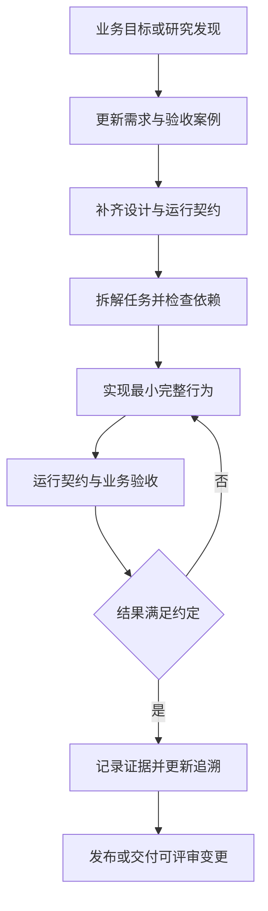

# AgentOS SDD 工作规范

SDD 在本项目中指规范驱动开发（Specification-Driven Development）。需求定义业务行为，技术设计解释实现方案，运行契约规定可互操作的语义，验收案例给出可观察的完成条件。

## 文档职责与状态

| 文档 | 唯一负责的内容 |
| --- | --- |
| requirements/agentos-platform.md | REQ 编号、产品范围、指标计算口径与目标 |
| design/technical-design.md | 模块关系、存储、算法、部署和流程 |
| specs/runtime-contracts.md | 字段、接口、错误、幂等、状态和授权语义 |
| specs/component-contracts.md | 通用组件、协议、沙箱、围栏、RAG与编码能力契约 |
| specs/acceptance.md | AC 编号、前置条件、操作和期望结果 |
| plan/implementation-plan.md | TASK 编号、依赖、负责人或角色及证据状态 |
| research/arxiv-2026-h2.md | 论文来源、实验边界及采用理由 |
| research/opensource-agent-components.md | 开源源码与官方协议的版本、机制及选型依据 |
| research/language-and-requirements-review.md | 团队语言分工、第一性原理复核及CubeSandbox适配依据 |
| design/review-log.md | 变更后的调研、替代方案比较和审核证据 |
| CONTEXT.md | 领域术语 |

当前规范状态为 Draft，用户确认范围后可标为 Accepted。后续可经历 Implemented 和 Verified，分别表示实现已存在、验收证据已检查。文档中声明完成必须附对应证据。指标调整在最终验收集解封前确定并版本化。

## 开发流程



代码结构已确认，开发与测试模块同步推进。本轮将测试执行交给用户统一安排。遇到未确认假设时记录其适用条件，会改变业务目标、权限范围或已确认验收标准的决定需要用户明确选择。

## 每轮更新后的研究与审核

将一次相关需求、设计、契约和案例修改视为一个版本批次。批次完成后再次核验受影响的原始来源及版本，比较至少一个合理替代方案，检查正常、失败、并发、恢复及权限路径，复核REQ—AC—TASK追溯。实质问题修正后复审受影响范围，记录结果再交付。

“方案最优”按已确定约束下的可解释选择判断。比较质量、时延、总成本、隔离、可恢复性、兼容性和运维复杂度。没有基准实验的取舍标为候选，记录将改变决定的证据。文档审核不能证明运行效果，也不要求无限重复没有新证据的审查。

## 变更规格格式

为一个有独立行为的变更建立 docs/changes/下的 Markdown 文件，开发任务开始时再创建。简单文字修正可在原文档直接维护。变更规格使用以下内容，按变更复杂度填写。

```markdown
# 变更名称

状态为 Draft。关联 TASK 与 REQ 编号。

## 目标与用户行为

说明触发条件、使用者和期望结果。

## 契约变化

列出输入、输出、状态、错误、授权及兼容影响。

## 实施与迁移

描述模块变更、旧数据处理、并发和回退方案。

## 验收与证据

引用 AC 编号，补充本变更特有案例。
记录运行命令、环境、结果及证据位置。

## 假设与待决项

记录影响范围和当前采用的可逆假设。
```

## 接口与数据规范

公共接口使用语义化版本，破坏兼容的修改提升主版本并提供迁移期。持久化状态有独立 Schema 版本。发布清单固定实现与配置的内容摘要，声明可读取的旧状态版本以及迁移能力。

所有接口同时约定调用顺序、身份来源、幂等范围、错误语义和性能预算。成功返回代表的持久化阶段必须明确。禁止将暂存成功描述为索引、派生记忆或外部动作全部完成。

## 验收与证据规范

单个 AC 的证据包含测试标识、关联版本、输入和初始状态、观察结果、判分规则及运行环境。敏感数据使用脱敏样例或有访问控制的证据引用。行为测试通过真实入口执行，桩和故障注入的使用范围必须记录。

评测报告包含数据集及划分摘要、模型与插件版本、缓存与并发条件、预算、全部失败、异步成本、评分覆盖率和置信区间。最终验收数据与优化器身份隔离，解封记录与候选内容摘要关联。指标和公式以需求文档为准。

## 追溯检查

每个有效 REQ 至少对应一个 AC 和一个 TASK。每个 TASK 说明前置依赖和可观察产物。所有采用的论文方法在调研中说明适用范围，并通过 TASK 关联到需求。案例可以覆盖多个需求，但应逐项写出观察结果。

文档交付检查文件链接、引用编号、流程图语法、状态和错误用语的一致性。实现阶段增加契约测试、迁移与恢复测试、业务端到端测试及约定的性能实验。M1 的测试入口及执行前提见[首个受管任务变更规格](../changes/m1-managed-support.md)。
